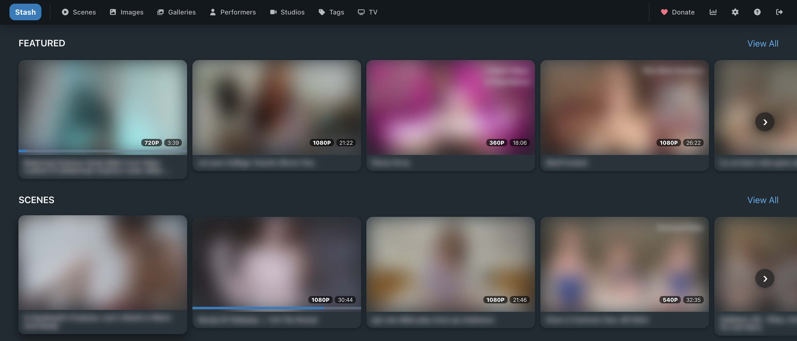

# Stash Plugins

Plugins for [Stash](https://stashapp.cc):

| Plugin | What it does |
| --- | --- |
| [Modern UI](plugins/ModernUI) | A cleaner, app-like look for Stash, with a phone-friendly layout, light and dark themes, an A–Z tag index, and "Suggested" / "Similar" rows on scene, image and performer pages. |
| [Vertical Cover Stitcher](plugins/VerticalStitcher) | Turns portrait (vertical) videos' covers into proper 16:9 covers by stitching several frames side by side. |
| [Privacy Blur](plugins/PrivacyBlur) | One switch in its settings (or Shift+Alt+B) blurs every picture and video in Stash, and optionally names and titles. Good for screenshots or browsing in company. |



*Modern UI's home page on a computer, with Privacy Blur turned on.*

## Installing

1. In Stash, go to **Settings → Plugins → Available Plugins** and click **Add Source**.
2. Enter:
   - **Name:** anything you like, e.g. `My Plugins`
   - **Source URL:** `https://OpenSourceLuffy.github.io/stash-plugins/main/index.yml`
3. Open the new source, tick the plugins you want and click **Install**.
4. Reload the page (or click **Reload plugins** under Settings → Plugins).

Updates show up in the same place whenever a new version is published.

## For maintainers

Plugins live in [`plugins/`](plugins), one folder per plugin. The plugin's ID is the name of its `.yml` file.

Every push to `main` that changes something under `plugins/` runs the
[deploy workflow](.github/workflows/deploy.yml), which runs
[`build_site.sh`](build_site.sh) to zip each plugin, write `index.yml` and publish
it to GitHub Pages. One-time setup: **Settings → Pages → Build and deployment →
Source: GitHub Actions**.

To release an update, change the plugin's files, bump `version:` in its `.yml`
and push.

To check the build locally:

```sh
./build_site.sh _site/main
cat _site/main/index.yml
```

## License

The plugins are released under the [MIT License](LICENSE).
`build_site.sh` comes from Stash's
[plugin repository template](https://github.com/stashapp/plugins-repo-template)
and stays under its original AGPL-3.0 license.
