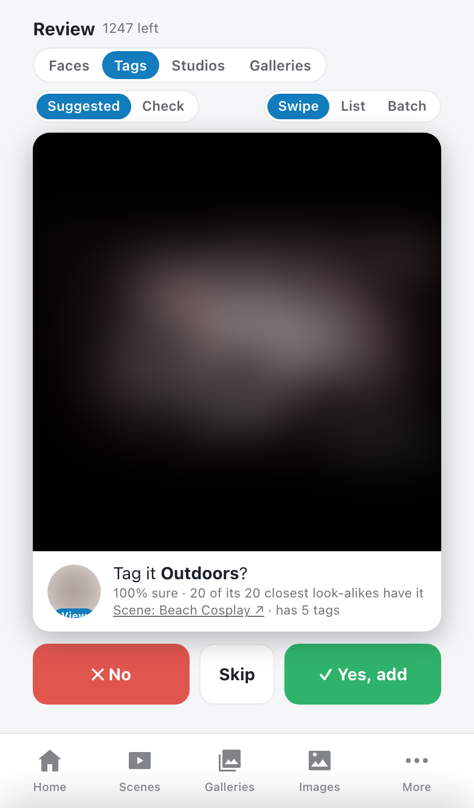
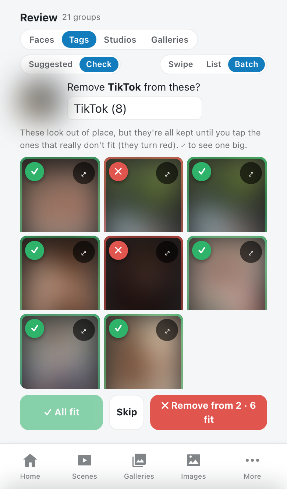
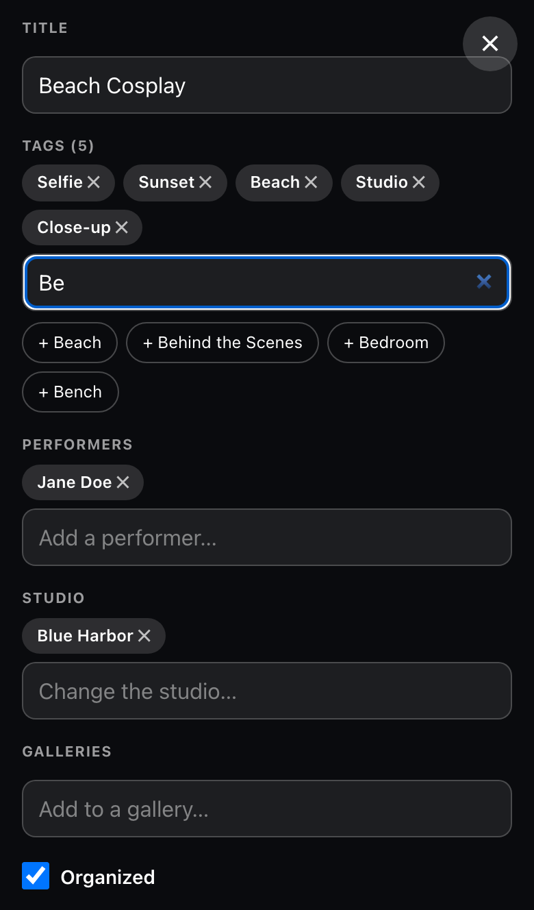
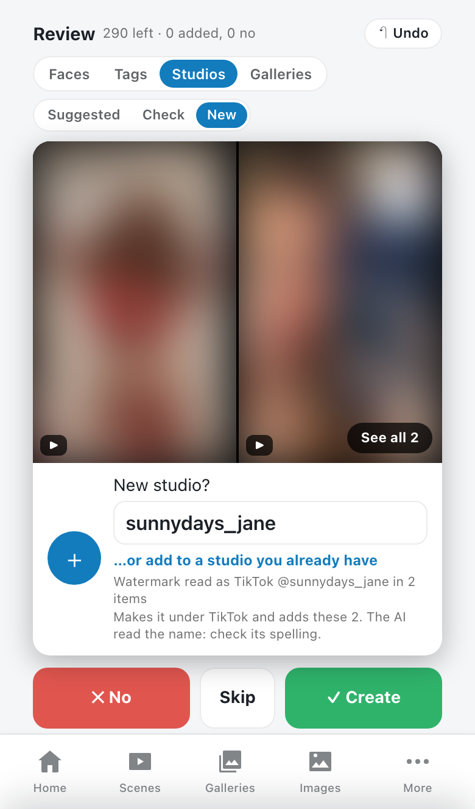
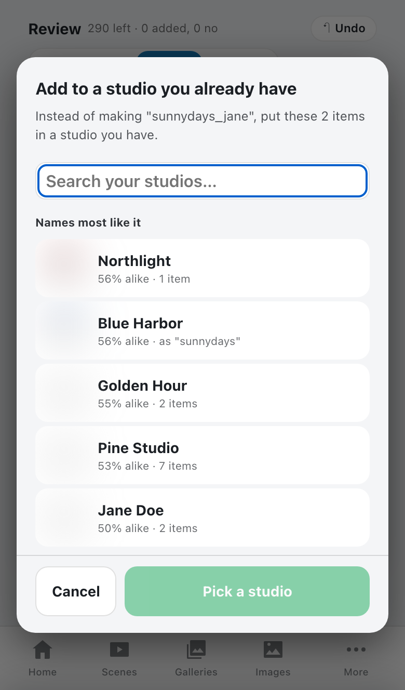
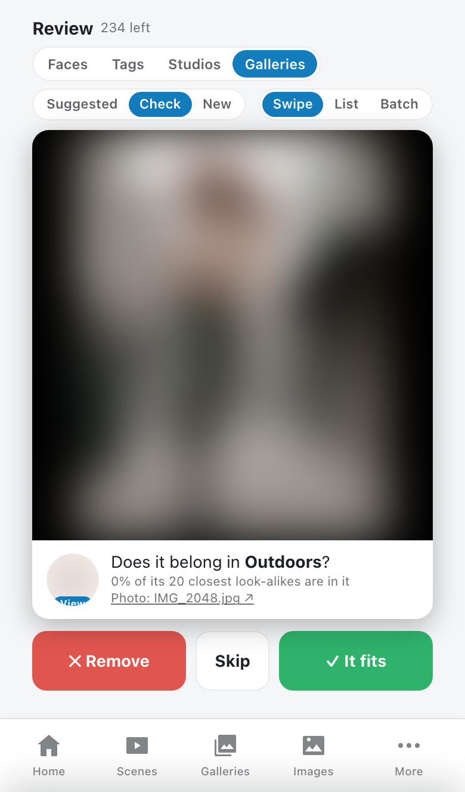
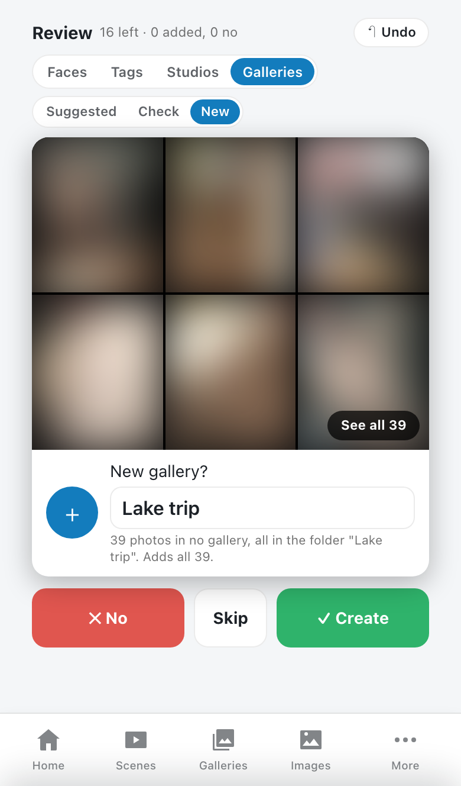

# Better Tagging AI Add-on (local AI)

Local AI for Stash: it tags scenes and images, writes titles, recognises your performers' faces,
finds a scene's studio from the account in its watermark, and tidies up studios and galleries.
Everything runs on your own computer (an [Ollama](https://ollama.com) model plus a small helper
program), so no picture ever leaves it.

It's an add-on for [Better Tagging Tools](../BetterTaggingTools) and works best next to it (it then
uses that plugin's **Tags to ignore**, **Special spellings** and gallery-name tags), but it also
works on its own.

## How it's different from other Stash AI plugins

It was made because the existing Stash AI tagging plugins didn't work on a Mac: their models need
a particular graphics card (NVIDIA, with CUDA). Other options send your pictures to an online
service, or come with a fixed list of tags they were trained on. This add-on:

- **Runs on a Mac (and any ordinary computer).** No special graphics card: it uses models that run
  well on Apple Silicon and on a normal processor (about 5 seconds a picture on an Apple M4). Linux
  works too; on Windows, Ollama works but the face helper is untested.
- **Stays on your computer.** A small open model in Ollama and a tiny local helper; nothing is
  uploaded, nothing needs an account.
- **Learns your tags, not someone else's.** It only ever picks from your own tag list, and learns
  from what you've already tagged: an item gets the tags of the items you've tagged that look most
  like it. The AI model's own picks are only kept when those look-alikes back them up.
- **Suggests; you decide.** The **Review** page shows its suggestions one at a time (or in batches)
  to accept with a swipe, and every change can be undone. Tasks only ever add, never remove.
- **Does more than tags.** Faces, studios from watermarks, titles, performers' hair and eye colour,
  and tidying up studios and galleries.

<table><tr><td></td><td></td><td></td></tr></table>

*The Review page: a suggestion to swipe, Batch view (tap the ones that don't fit), and editing a
scene by hand. (Pictures blurred; every name, title and tag is an example.)*

## Features

- [**Review page**](#review): suggestions for faces, tags, studios and galleries, to accept, turn
  down or undo.
- [**While editing**](#while-editing): "Ask AI" buttons for tags and titles, and suggested tags,
  performers (by face) and galleries.
- [**Tasks**](#tasks): AI tags, look-alike tags, body tags, titles, studios from watermarks, faces,
  tag pictures and performer details for the whole library.
- [**New items after a scan**](#new-items-after-a-scan): the same for new items, with the slow AI
  steps saved for the night if you like.
- [**Other plugins' pages**](#on-other-pages): face matches on performer pages, and better rows in
  [Stash Suggestions](../StashSuggestions).

## Review

**Review** in Stash's menu (on a phone with [Modern UI](../ModernUI): **More → Review**). The top
row is what's reviewed (**Faces**, **Tags**, **Studios**, **Galleries**); under it, what to do:

- **Suggested**: what's likely missing.
- **Check**: what's already there that may be wrong.
- **New**: performers, studios or galleries you don't have yet.

Tapping a tab goes back to the action you used last there.

**How it works on every tab**
- Swipe right (or **✓**) to accept, left (**✕**) to never be asked again, **Skip** to leave it, **↶ Undo**
  to take the last answer back. On a computer: → yes, ← no, ↓ skip, Z undo.
- **Swipe | List | Batch**: one at a time, a grid of them all, or one performer's / tag's suggestions
  at a time with everything ticked, so you only tap the ones that don't fit (Undo takes a whole batch
  back). The view you pick is remembered.
- Tap a picture to see it full screen with its tags, performers, studio and galleries; a scene plays
  from just before the matched moment. **✎ Edit this scene / photo** changes it by hand, whatever
  the card was suggesting (title, tags, performers, studio, galleries, Organized).
- Tap a performer's, tag's or studio's picture to open their page; the **✕** in the top right (or
  Back) brings you back to the same card.
- At the end: **↻ Check for new suggestions**, or **Show the skipped ones again**.

**Faces**
- *Suggested*: strong face matches ("Is this … ?"): very alike, clearly ahead of every other
  performer, and in a scene the best match in two or more frames. Yes also learns that face.
- *Check*: "Is [performer] in this?" when their face is known, faces were found, and none look like
  them. **✕ Remove** takes them off.
- *New*: the same face in 3 or more items without a performer. **Is this [them]?** when a quarter or
  more of those items already have one performer whose face isn't known yet; otherwise **New
  performer?** with name ideas (from accounts in file names and links, shared studios and folders,
  name-like tags, and text the AI reads in the pictures). Creating asks first, showing the card it
  will make, with gender, tags and more details; **…or add to a performer you already have** lists
  the closest faces. Tap the pictures to leave some items out.

**Tags**
- *Suggested*: tags that 50% or more of the 20 closest look-alikes you've tagged have.
- *Check*: "Does [tag] fit?" when under 5% of its look-alikes have it, only for tags look-alikes
  judge well. **✓ It fits** never asks again.

**Studios** (mostly the ones made from watermarks)
- *Suggested*: **Add these to [studio]?** for items without a studio in galleries or folders where
  most of the rest have one, or when a name read in a watermark is close to a studio you have.
- *Check*: **Merge these into one studio?** for names that are the same written differently or
  misreadings of each other (pick which one to keep and its name; the others become its aliases),
  and **Delete [studio]?** for junk, empty, or read-once studios.
- *New*: **New studio?** for an account name read in a watermark only once so far, with the pictures
  it was read in to check the spelling. **…or add to a studio you already have** lists the closest
  names; the watermark's name becomes an alias so it's found next time.

<table><tr><td></td><td></td></tr></table>

**Galleries**
- *Suggested*: **Add these to [gallery]?** for photos in no gallery that look like its photos or sit
  in its folder, and **Add to the gallery [gallery]?** for the performers / studio most of its photos
  have.
- *Check*: **Does it belong in [gallery]?** for photos that look like none of the rest. **✕ Remove**
  takes it out of the gallery (the photo isn't deleted).
- *New*: **New gallery?** for a folder of 5+ photos in no gallery, named after the folder.

<table><tr><td></td><td></td></tr></table>

Suggestions need the face and look-alike scans (see [Setup](#setup)). Undo works for everything,
merges and deletes included (a deleted studio is made again with its items). Your "No"s are kept in
small files in the plugin's folder.

## While editing

- **Tags** box (scenes and images): **Tags from look-alikes** load by themselves, e.g.
  `+ Outdoors 72% ✓`. **Ask AI for tags** adds the model's picks (✓ = look-alikes agree) and ideas
  for tags you don't have yet, which you can make with one tap.
- **Performers** box: **Find performers by face** shows the closest performers with how alike they
  look (✓ = confident).
- **Title** box (scenes, images, galleries): **Ask AI for titles** suggests a few, from the picture,
  performers, studio, tags and file name.
- **Galleries** box (images): the galleries its 20 closest look-alikes are in, e.g. `+ Holiday 64%`.
- Performer **Edit**: **Ask AI for details** suggests hair and eye colour, tattoos and piercings.

Nothing is saved until you click a suggestion and save.

## Tasks

Under **Settings → Tasks → Plugin Tasks → Better Tagging AI Add-on (local AI)**. Each section starts with a
preview that only writes to the log; tasks only add, skip what's done, and carry on where they
stopped if cancelled.

- **AI tagging**: the model sees a picture (for a scene, 4 frames in one picture) and picks from your
  250 most used tags, so it never invents tags; its picks are kept only when look-alikes back them up.
  Items with more than 5 tags skip the model.
- **Look-alike tags**: **Scan scenes and images** fingerprints every item once (well under a second
  each). An item then gets the tags most of its 20 closest look-alikes have. The add-on's own tags are
  never learned from (except on items you've marked organized), and a tag you keep removing stops
  being added.
- **Body tags**: a body-part detector adds which parts are shown, using your tags for them; sizes
  come from the performer (the size you usually tag them with, or their cup size and details). Items
  that already have a body tag are skipped.
- **AI titles**: scenes or images without a title get one from the file name, or the AI's best idea.
- **Studios from accounts / watermarks**: scenes and photos without a studio get one from an account
  in their file name or links, or one the model reads in a watermark. A new name read only in
  watermarks needs a second sighting; near misses of a studio or performer you have (letters that
  look alike, like 1/l and 0/o) count as that one. New studios go under a platform studio
  (**OnlyFans**, **Fansly**, **Patreon**, **Instagram**, **TikTok**), and matching performers are added.
- **Faces**: scan every item's faces once, learn performers' faces (profile pictures, then photos
  where they're alone), find who's in items without performers, and list performers who may be the
  same person. Confident matches can be added automatically.
- **Tag pictures**: give tags their most typical scene or photo (from the look-alike fingerprints),
  never using one picture twice; also from the Tags list (**••• → Most typical picture (AI)**).
- **Performer details**: fills empty hair and eye colour only when two looks at different photos agree.

## New items after a scan

Turn on what you want in the settings: AI tags, AI titles, studios from watermarks, faces. With
**AI: wait until night for new items** on, new items get only the quick steps right after the scan
(file-name tags, look-alike tags, body tags, faces; about a second each) and the AI model's steps run
once at **AI: night time** (default 03:00), so a big scan doesn't hold Stash up for hours.

## On other pages

- **Performer pages**: a **Faces** row, **Might also be in…**, lists scanned items where someone looks
  like them; tick the right ones and add them, or open them in Review.
- **[Stash Suggestions](../StashSuggestions)** (1.1 or later): its Similar Performers, Similar photos
  and Suggested rows also count how alike faces and pictures look.

## Setup

You need two things on the computer Stash runs on (or one it can reach). Each is optional; anything
that needs a missing part says so in the log and does nothing.

### 1. Ollama and the AI model (for everything that says "AI")

1. Install [Ollama](https://ollama.com): on a Mac `brew install ollama` then
   `brew services start ollama`; on Linux `curl -fsSL https://ollama.com/install.sh | sh`; on
   Windows, the installer from ollama.com.
2. Download the model: `ollama pull gemma3:4b` (about 3.3 GB;
   [ollama.com/library/gemma3](https://ollama.com/library/gemma3)). Check it with
   `curl http://localhost:11434/api/tags`.
3. Set **AI: Ollama address**: the default `http://host.docker.internal:11434` works for Stash in
   Docker Desktop on the same computer; use `http://localhost:11434` for Stash installed directly.
   For Stash in Docker on Linux, run the container with `network_mode: host` and use
   `http://127.0.0.1:11434` (Ollama and the face helper only listen on the computer itself).
4. Run **AI tagging: preview on 10 items (no changes)**; the log shows what it would add, or what's
   missing.

### 2. The face helper (for faces, look-alikes and body tags)

A tiny local program that turns pictures into "fingerprints". From this plugin's folder
(`plugins/BetterTaggingAI`):

```sh
sh face-helper/setup.sh                      # install and start it
sh face-helper/setup.sh --from /backup/dir   # the same, with every model from a backup folder
```

- **Needs** Python 3.10–3.14 (picked automatically, or `PYTHON=python3.13`) and `curl`. Mac and
  Linux; Windows is untested.
- **Installs** OpenCV, NumPy, ONNX Runtime and the models (about 650 MB) in
  `~/Library/Application Support/face-helper` (Mac) or `~/.local/share/face-helper` (Linux; or set
  `FACE_HELPER_DIR`). The small models come with the plugin in [`face-helper/models`](face-helper/models);
  the CLIP model is downloaded. On a Mac it starts at login; on Linux it prints the command to run.
- **Check it:** `curl http://127.0.0.1:11535/health` answers `{"ok": true, ...}`. It listens only on
  your computer (port 11535, or `FACE_HELPER_PORT`) and sends nothing anywhere.
- On a Mac, keep it out of `Documents`, `Desktop` and `Downloads` (programs started at login can't
  read them). Run the script again after updating the plugin.
- **To remove it** on a Mac: `launchctl bootout gui/$(id -u)/face-helper`, then delete
  `~/Library/LaunchAgents/face-helper.plist` and the `face-helper` folder (and `ollama rm gemma3:4b`).

### 3. First runs

Run **Look-alike tags: scan scenes and images** and **Faces: scan scenes and images** once (a while
on a big library; cancel and rerun to carry on), then turn on the after-scan settings you want.

## Which models, and why

Each job uses the smallest model that does it well, so it all runs on an ordinary computer.

| Job | Model | Size | Why |
| --- | --- | --- | --- |
| Tags, titles, watermarks, hair and eye colour | **Gemma 3 4B** (Google), in Ollama | 3.3 GB | The smallest model that describes pictures well; about 5 s a picture (a scene about 15) on an Apple M4. |
| Finding faces | **YuNet** (OpenCV) | under 1 MB | Made only for finding faces; fast without a graphics card. |
| Telling faces apart | **SFace** (OpenCV) | 39 MB | Turns a face into numbers that match for the same person, so *your* performers can be recognised. |
| Look-alikes | **CLIP ViT-B/32** (OpenAI) | 350 MB | Describes a whole picture as numbers, so the items you've tagged that look most alike can be found. |
| Body tags | **NudeNet 320n** | 12 MB | A detector made for this; far more consistent than asking a general model. |

- **Why not a bigger model?** `gemma3:12b` or `27b` are more accurate but 3–7 times slower and need
  8–20+ GB of memory: hours become days on a big library. Instead the small model is checked: on its
  own its tags matched the ones you'd give 8–20% of the time; kept only when look-alikes agree,
  70–78%. Look-alike tags alone were 79–85% right for items like ones you've tagged.
- **Watermarks:** asked for an account name directly, small models make one up, so the model only
  copies out the text it sees, the plugin picks the names out, and a name needs two frames to agree.
- You can try another vision model with **AI: model**; only `gemma3:4b` has been tested.
- **Licences:** Gemma 3 is under Google's [Gemma terms](https://ai.google.dev/gemma/terms) (not
  included; `ollama pull gemma3:4b`). YuNet (MIT), SFace (Apache 2.0) and NudeNet 320n (AGPL-3.0)
  are in [`face-helper/models`](face-helper/models) with their licences; CLIP (MIT) is downloaded.
  See [`face-helper/models/README.md`](face-helper/models/README.md).

## Settings

Under **Settings → Plugins → Better Tagging AI Add-on (local AI)**:

| Setting | What it does |
| --- | --- |
| AI: tag new scenes and images automatically | AI-tag new items after a scan. |
| AI: tag, title and find the studio of new scenes and images | All three AI steps for each new item after a scan. |
| AI tagging: which items | `scenes`, `images` or both (empty): which items the AI model tags, in the tasks, after a scan and at night. |
| AI titles: which items | `scenes`, `images` or both (empty): which new items get an AI title. |
| AI: read watermarks on new photos | Studio (and performers) from the watermark of each new photo without a studio. |
| AI: Ollama address | Default `http://host.docker.internal:11434`. |
| AI: model | Default `gemma3:4b`. |
| AI: tags to choose from | How many of your most used tags the model picks from. Default 250. |
| AI: most tags per item | Default 6. |
| AI: don't auto tag from file names first | Skip the file-name matching before the AI looks at an item. |
| AI: include organized items | Also AI-tag items marked as organized. |
| AI: body tags every night | At night, run body tags for everything not checked yet. |
| AI: look-alike suggestions from (%) | Edit page "Tags from look-alikes" cut-off (default 20). The tasks only add at 50%+. |
| AI: skip items with more tags than | Items with more tags (default 5) skip the AI model; body tags still run. 0 never skips. |
| AI: wait until night for new items | New items get the quick steps after a scan; the AI model's steps wait for the night. |
| AI: night time | When the saved AI work runs (HH:MM). Default 03:00. |
| AI: time zone | Time zone of the night time, e.g. `America/New_York`. Default UTC. |
| Faces: add confident matches automatically | Let the Faces tasks (and new scans) add confident matches. |
| Faces: likeness needed to add automatically (%) | Default 50 (images 5 more). |
| Faces: likeness needed to suggest (%) | Default 36. |
| Faces: helper address | Default `http://host.docker.internal:11535`. |

AI settings set in Better Tagging Tools before the AI had its own plugin still count until you
change them here.

## Requirements and notes

- Stash v0.31 (tested); Python 3 (standard library only); ffmpeg (the one Stash uses).
- Ollama with a vision model, and the face helper, as in [Setup](#setup).
- The AI gets most things right but not all: check the previews, and use **Review** or the **Ask AI**
  buttons where accuracy matters.
- The code is in `btt_core.py`, shared with Better Tagging Tools, so each plugin works on its own.
  Small files in the plugin's folder remember what's been done; deleting them is safe.
- Works with any theme. Changes are listed in the [changelog](CHANGELOG.md).
