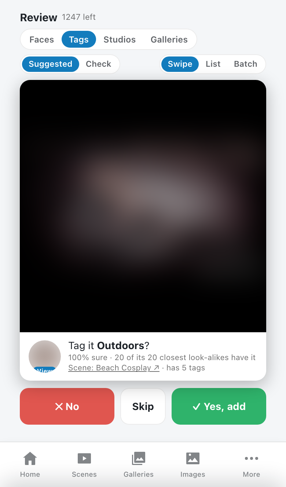
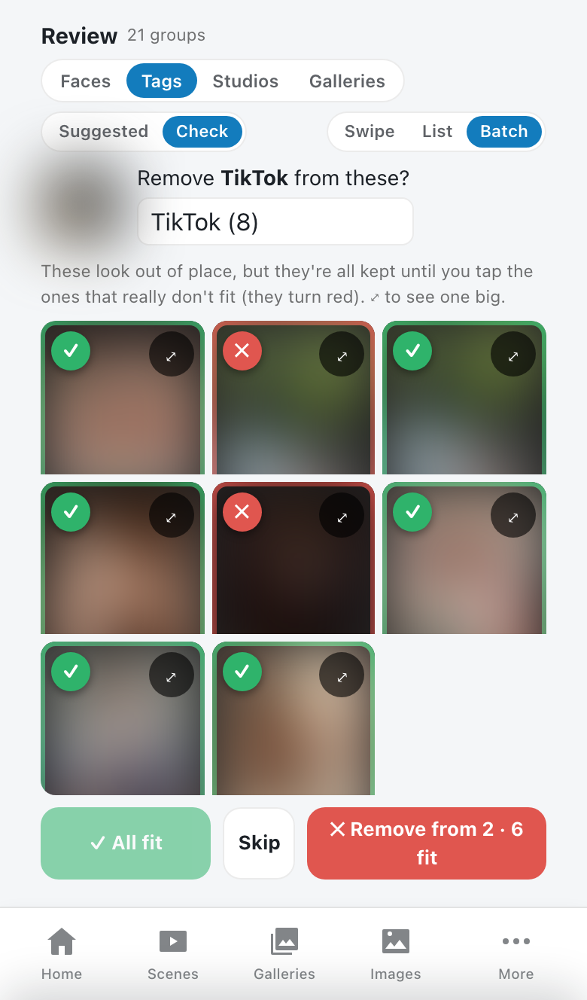
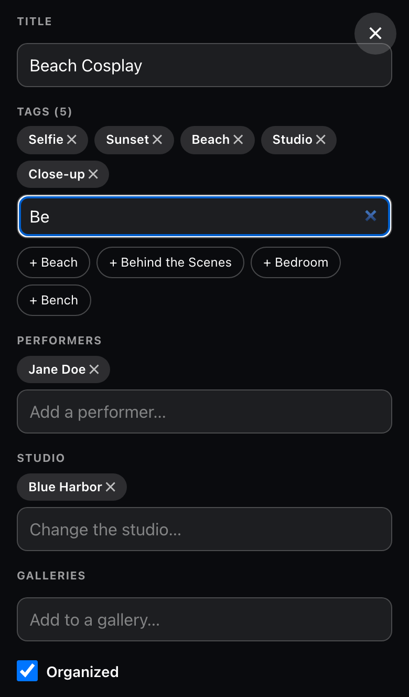
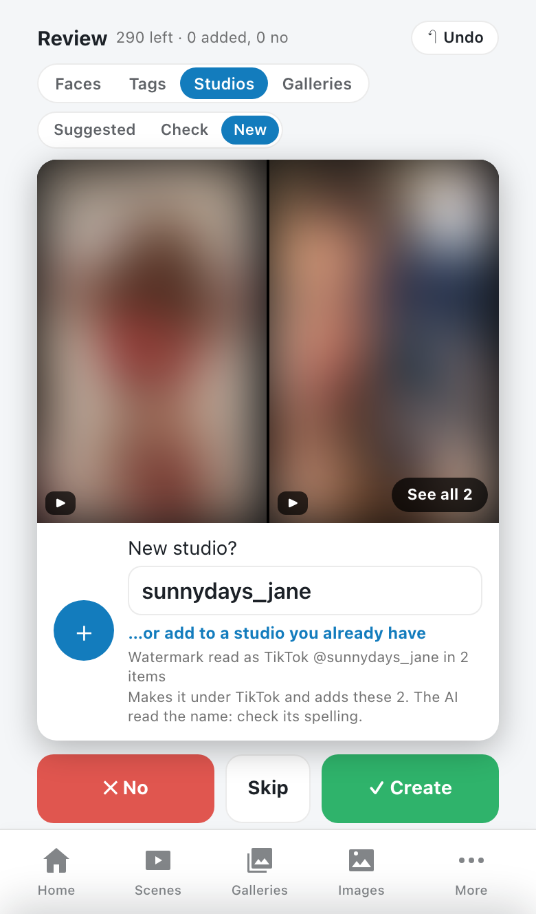
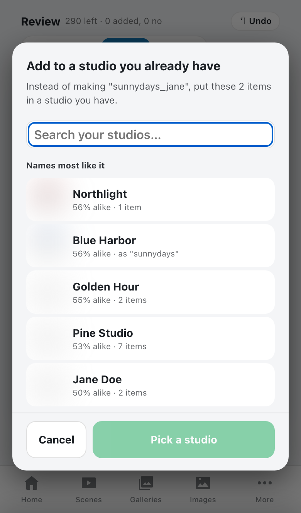
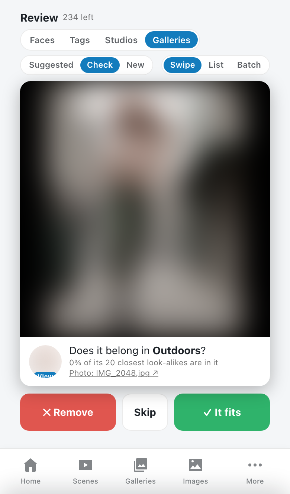
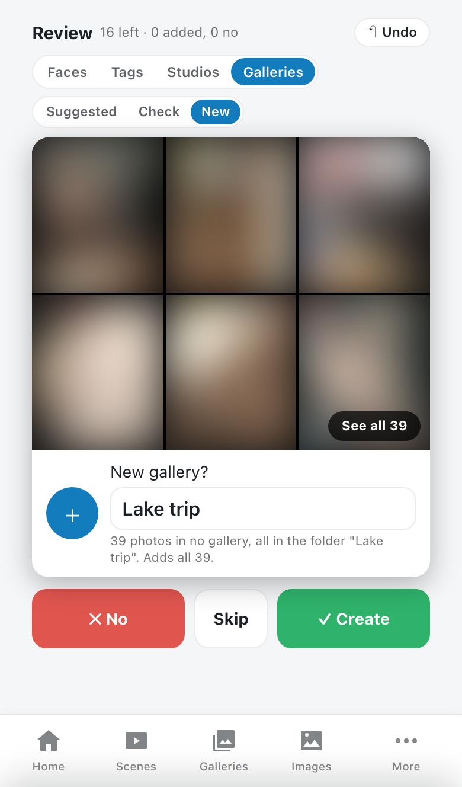

# Better Organizing AI Add-on (local AI)

Local AI for Stash: it tags scenes and images, writes titles, recognises your performers' faces,
finds a scene's studio from the account in its watermark, and tidies up studios and galleries.
Everything runs on your own computer (an [Ollama](https://ollama.com) model plus a small helper
program), so no picture ever leaves it.

It's an add-on for [Better Organizing Tools](../BetterTaggingTools) and works best next to it (it then
uses that plugin's **Top tags: tags to ignore**, **Naming: special spellings (tags too)** and gallery-name tags), but it also
works on its own.

> **Models: what comes with it, and what you can change**
>
> | Model | Used for | Comes with the plugin? | Can you switch it? |
> | --- | --- | --- | --- |
> | YuNet (0.2 MB) | Finding faces | ✅ Included, in [`face-helper/models`](face-helper/models) | No |
> | SFace (39 MB) | Recognising performers' faces | ✅ Included | No |
> | NudeNet 320n (12 MB) | Body tags | ✅ Included | No |
> | CLIP ViT-B/32 (350 MB) | Look-alike tags, galleries and suggestions | ⬇️ Downloaded by `setup.sh` (too big for GitHub) | No |
> | Gemma 3 4B (3.3 GB) | Everything marked "(AI model)", and Ask AI: tags, titles, watermarks, hair and eye colour | ⬇️ You download it: `ollama pull gemma3:4b` ([ollama.com/library/gemma3](https://ollama.com/library/gemma3)) | **Yes**: set **Setup: AI model (in Ollama)** to any Ollama model that can see pictures (e.g. `gemma3:12b`, more accurate but slower). Only `gemma3:4b` has been tested. |
>
> The face helper's four models are fixed: the plugin's face fingerprints, look-alikes and body
> tags are built around them, so they can't be swapped from the settings. See
> [Setup](#setup) and [Which models, and why](#which-models-and-why).

## How it's different from other Stash AI plugins

It was made because the existing Stash AI tagging plugins didn't work on a Mac: their models need
a particular graphics card (NVIDIA, with CUDA). Other options send your pictures to an online
service, or come with a fixed list of tags they were trained on. This add-on:

- **Runs on a Mac (and any ordinary computer).** No special graphics card: it uses models that run
  well on Apple Silicon and on a normal processor (about 5 seconds a picture on an Apple M4). Linux
  works too, and so does Stash running natively on Windows (from 1.6.1); there the face helper is
  set up by hand, as `setup.sh` doesn't run on Windows.
- **Stays on your computer.** A small open model in Ollama and a tiny local helper; nothing is
  uploaded, nothing needs an account.
- **Learns your tags, not someone else's.** It only ever picks from your own tag list, and learns
  from what you've already tagged: an item gets the tags of the items you've tagged that look most
  like it. The AI model's own picks are only kept when those look-alikes back them up.
- **Suggests; you decide.** The **Review** page shows its suggestions one at a time (or in batches)
  to accept with a swipe, and every change can be undone. Tasks only ever add, never remove.
- **Does more than tags.** Faces, studios from watermarks, titles, performers' hair and eye colour,
  and tidying up studios and galleries.

<table><tr><td></td><td></td><td></td></tr></table>

*The Review page: a suggestion to swipe, Batch view (tap the ones that don't fit), and editing a
scene by hand. (Pictures blurred; every name, title and tag is an example.)*

## Features

- [**Review page**](#review): suggestions for faces, tags, studios and galleries, to accept, turn
  down or undo.
- [**While editing**](#while-editing): "Ask AI" buttons for tags and titles, and suggested tags,
  performers (by face) and galleries.
- [**Tasks**](#tasks): AI tags, look-alike tags, body tags, titles, studios from watermarks, faces,
  tag pictures and performer details for the whole library.
- [**New items after a scan**](#new-items-after-a-scan): the same for new items, with the slow AI
  steps saved for the night if you like.
- [**Other plugins' pages**](#on-other-pages): face matches on performer pages, and better rows in
  [Stash Suggestions](../StashSuggestions).

## Welcome and tour

The first time the add-on runs, a welcome says what it does, lists what's ready and what still needs
setting up, and offers a tour: one feature per slide, each with a screenshot, where to find it and an
**Open it** link (swipe, Back / Next, or the dots). **Remind me later** asks again the next day;
**Don't show again** turns it off (setting **Setup: hide the welcome and tour**). The setup
page's **Show the welcome tour** opens it any time.

When something isn't set up yet, the welcome offers **Set it up with me** instead: a setup guide with
only the steps you still need (install the face helper, update it, scan your library's looks, install
the AI model in Ollama, get the video model), each with a screenshot, the commands to copy, where the add-on
looks for things (with the right address when Stash runs in Docker), the common problems for that step,
and **Check again** to tick it off. When everything's done it offers the tour. The setup page's
**Setup guide** button opens it too.

Features that need something that isn't installed yet (the face helper and its models, Apple's
Vision, CLIP's text model, the AI model in Ollama, the video model, a look-alike scan) stay hidden
until it is - Review's tabs, the Search link, Ask AI for tags, faces, AI markers and the rest.

## Search by description

**Search** in Stash's menu opens a page where you describe what you're looking for, e.g. *red dress
at the beach*, *kneeling on a bed*, *black and white photo*. Your words are turned into a CLIP
fingerprint and compared with how every photo, scene and AI marker looks (the look-alike
fingerprints), so it finds things no tag or title says. Toggle Photos / Scenes / Markers, and filter
photos by their aesthetic score. It needs the face helper (with CLIP's text model, which `setup.sh`
downloads) and "Tags: scan scenes and images for look-alikes (do this first)".

Describe what's in the picture in plain English (CLIP knows English best); a few wordings are tried
together ("a photo of …", and "a photo of a woman, …" when no person is named), near-identical
pictures show once, and at most two results come from one scene, so one video doesn't fill the page.
When nothing looks much like the words it says so. Poses are its weakest point.

## Review

**Review** in Stash's menu (on a phone with [Modern UI](../ModernUI): **More → Review**). The top
row is what's reviewed (**Faces**, **Tags**, **Studios**, **Galleries**); under it, what to do:

- **Suggested**: what's likely missing.
- **Check**: what's already there that may be wrong.
- **New**: performers, studios or galleries you don't have yet.

Tapping a tab goes back to the action you used last there.

**How it works on every tab**
- Swipe right (or **✓**) to accept, left (**✕**) to never be asked again, **Skip** to leave it, **↶ Undo**
  to take the last answer back. On a computer: → yes, ← no, ↓ skip, Z undo.
- **Swipe | List | Batch**: one at a time, a grid of them all, or one performer's / tag's suggestions
  at a time with everything ticked, so you only tap the ones that don't fit (**Select all** / **Deselect
  all** to start from one end; Undo takes a whole batch back). The view you pick is remembered.
- Tap a picture to see it full screen with its tags, performers, studio and galleries; a scene plays
  from just before the matched moment. **✎ Edit this scene / photo** changes it by hand, whatever
  the card was suggesting (title, tags, performers, studio, galleries, Organized).
- Tap a performer's, tag's or studio's picture to open their page; the **✕** in the top right (or
  Back) brings you back to the same card.
- At the end: **↻ Check for new suggestions**, or **Show the skipped ones again**.

**Faces**
- *Suggested*: strong face matches ("Is this … ?"): very alike, clearly ahead of every other
  performer, and in a scene the best match in two or more frames (marker pictures count as frames).
  Yes also learns that face.
- *Check*: "Is [performer] in this?" when their face is known, faces were found, and none look like
  them. **✕ Remove** takes them off.
- *New*: the same face in 3 or more items without a performer. **Is this [them]?** when a quarter or
  more of those items already have one performer whose face isn't known yet; otherwise **New
  performer?** with name ideas (from accounts in file names and links, shared studios and folders,
  name-like tags, and text the AI reads in the pictures). Creating asks first, showing the card it
  will make, with gender, tags and more details; **…or add to a performer you already have** lists
  the closest faces. Tap the pictures to leave some items out.

**Tags**
- *Suggested*: tags that 50% or more of the 20 closest look-alikes you've tagged have, and positions
  seen in a scene's video (with the [video model](#positions-in-videos-optional-video-model)), with
  the moments they were seen (tap the picture to jump there). When both point to the same tag it's one
  card, shown first; otherwise every fifth card is one from the video. Items with 3 tags or fewer
  also get body tags the body detector was nearly sure of (within 0.08 of what it needs to add one
  itself), marked "just under the body detector's bar"; fewest tags first. Markers come first: when one of a
  scene's markers is suggested the same tag, the card is that marker's ("Tag this marker …?"), since a
  marker shows more clearly what's going on; Yes tags the marker and the scene. A scene's markers count
  too: a tag its marker pictures look like in 2 or more markers is suggested like any other (the
  card shows the marker's picture and "seen in N of its markers"); a tag from one marker only is
  suggested but never added by itself.
- *Markers*: tags for each marker on its own: the tags its 20 closest look-alikes have (your tagged
  scenes and photos, and the markers you've tagged, never its own scene), and positions the video
  model sees in most of the marker's frames. Tags about the people (hair, ethnicity, tattoos, body type,
  age) are left to the scene. The scene's own tags count as a hint: a tag the scene has needs less
  look-alike support and ranks higher ("its scene has this tag"), but never comes from the scene alone.
  A card plays the scene from the marker; **Yes** tags the marker (and the scene, when it doesn't
  have that tag yet: see "Markers: add their tags to their scenes"). Every
  marker you tag is learned from, so the suggestions get better as you go (they're worked out again
  every 15 minutes, or with **↻ Check for new suggestions**).
- Poses (shown among *Suggested* for photos and *Markers* for markers, marked "pose: …"): body positions (**Face Down Ass Up**, **All Fours**, **Frog Pose**, **Kneeling**, **Squatting**,
  **Spread Legs**, **Legs Up**, **Bent Over**, **Lying on Stomach**, or your own list in the setting
  **Poses: pose tags to suggest**) for photos and markers, learnt from the ones you tag: tag at least 3 with a pose
  and the photos and markers closest to them are suggested, by body shape (Apple's body pose, on a
  Mac; run **Tags: scan images' body poses for pose suggestions (Mac)** first) and by look. Neither tool can tell these poses by
  itself (on 700 test pictures Apple found a whole body in about 1 in 6, and CLIP's descriptions
  mostly found bottoms), so they're only ever suggestions. **Yes** adds another example; **No** is
  remembered and counts against the pose next time.
- *Check*: "Does [tag] fit?" when under 5% of its look-alikes have it, only for tags look-alikes
  judge well. **✓ It fits** never asks again; **✕ Remove** takes it off and it stays off.
- **Removed tags stay removed:** a tag you take off an item (in Check, or anywhere in Stash when the
  add-on had added it), or say No to in Suggested, is never put back on that item by any task (AI
  tags, look-alikes, body tags, gallery / studio tags, tags from file names), and isn't suggested
  for it again.
- *Similar*: **Merge these two tags?** for the same name written differently (*Toy* / *Toys*) or two
  tags that are nearly always together (pick which to keep and its name; the other becomes an alias),
  and **Make [tag] a sub-tag of [tag]?** when one is a kind of the other: the end of its name (*Big Tits*
  under *Tits*, *Standing Missionary* under *Missionary*), its name before a qualifier (*Brown Hair
  (Female)* under *Brown Hair*), or a broader term (*Blowjob*, *Rimming* and *69* under *Oral*). Synonyms
  count (*Tits* = *Boobs* = *Breasts*, *Doggy Style* = *Doggystyle*), and so do a tag's aliases; add your
  own with the setting **Tags: synonyms** (`Oral = Blowjob` for the same thing, `Blowjob < Oral` for a
  kind of). **…or merge into [tag] instead** turns the sub-tag into an alias of the other. **⇅ Switch parent and sub-tag** puts them the other way round. A gallery counts as one place, so a long comic whose pages all
  share tags doesn't make them look alike. Undo puts a merged tag back with its items.
- *New*: **New tag for these?** for a group of pictures that look alike (each fingerprint compared
  after taking away the library's average look) and that no tag covers yet: type a name, or **…or add
  them to a tag you already have** (the tags already on some of them are listed). They may already
  have other tags or performers. A group that's mostly one gallery or folder isn't suggested (that's
  the gallery).

**Studios** (mostly the ones made from watermarks)
- *Suggested*: **Add these to [studio]?** for items without a studio in galleries or folders where
  most of the rest have one, or when a name read in a watermark is close to a studio you have.
- *Check*: **Merge these into one studio?** for names that are the same written differently or
  misreadings of each other (pick which one to keep and its name; the others become its aliases),
  and **Delete [studio]?** for junk, empty, or read-once studios.
- *New*: **New studio?** for an account name read in a watermark only once so far, with the pictures
  it was read in to check the spelling. **…or add to a studio you already have** lists the closest
  names; the watermark's name becomes an alias so it's found next time.

<table><tr><td></td><td></td></tr></table>

**Galleries**
- *Suggested*: **Add these to [gallery]?** for photos in no gallery that look like its photos or sit
  in its folder, and **Add to the gallery [gallery]?** for the performers / studio most of its photos
  have.
- *Check*: **Does it belong in [gallery]?** for photos that look like none of the rest. **✕ Remove**
  takes it out of the gallery (the photo isn't deleted).
- *New*: **New gallery?** for a folder of 5+ photos in no gallery, named after the folder.

<table><tr><td></td><td></td></tr></table>

Suggestions need the face and look-alike scans (see [Setup](#setup)). Undo works for everything,
merges and deletes included (a deleted studio is made again with its items). Your "No"s are kept in
small files in the plugin's folder.

## While editing

- **Tags** box (scenes and images): **Tags from look-alikes** load by themselves, e.g.
  `+ Outdoors 72% ✓`. **Ask AI for tags** adds the model's picks (✓ = look-alikes agree) and ideas
  for tags you don't have yet, which you can make with one tap.
- **Performers** box: **Find performers by face** shows the closest performers with how alike they
  look (✓ = confident).
- **Title** box (scenes, images, galleries): **Ask AI for titles** suggests a few, from the picture,
  performers, studio, tags and file name.
- **Galleries** box (images): the galleries its 20 closest look-alikes are in, e.g. `+ Holiday 64%`.
- Performer **Edit**: **Ask AI for details** suggests hair and eye colour, tattoos and piercings.
- The bulk **Edit** window (several scenes or images selected): an **AI** row under **Tags** with
  the look-alike tags that suit at least a quarter of them, e.g. `+ Beach 4/6`; **Add common** adds
  the ones that suit half or more.

Nothing is saved until you click a suggestion and save.

## Gallery chapters

On a gallery's **Chapters** tab, **✨ Suggest chapters** (next to Create Chapter) finds where the gallery
changes and suggests a chapter at each place: a new folder, file names that change (`beach_…` to
`pool_…`) or start counting again, a different look (the picture fingerprints; images after it look
like none just before it, so a mix of close-ups doesn't count), new performers or a new studio, much
changed tags, or a different day. Each suggestion shows its first image, where it starts and how many
images it covers, and a title from the folder's name, the file names, its performers, the tags that
stand out in it or its studio ("Part 2" when nothing does), which you can edit before **+ Add** (or
**+ Add all**). Tap a chapter's picture (or its "Image 40 · 32 images" line) to see its images and the
ones either side: tap one before or after it to add it, or one inside to trim the chapter from that
end (a chapter is a run of images, lasting until the next one starts, so the images trimmed off the end
go to the next chapter); **✕ Not a chapter** joins it to the one before. Added chapters are put away
(**Show added ones** brings them back). Galleries made of sets split best; a mixed collection mostly splits by folder and
performer.

**Comics** (a gallery from a zip or cbz) are read page by page instead: a chapter starts at each
page with a chapter heading ("CHAPTER 2: FED UP", "Ch. 12", "Episode 3"), titled from it. A heading
only counts when its number follows the last one, so "chapter" in a speech bubble doesn't start one.
A compilation without headings is split after each translator's credits page. This needs the face
helper's text reader (Apple's, so on a Mac: run `face-helper/setup.sh` again to add it); it reads
about 5 pages a second, a few hundred at a time with the progress shown, and remembers what it read.
In a 1,287-page manga it found 60 of its 64 chapters with their titles.

## Tasks

Under **Settings → Tasks → Plugin Tasks → Better Organizing AI Add-on (local AI)**. Pressing a task first checks
that what it needs is set up (if not, it says what's missing and opens the setup page), and a task
that would take 10 minutes or more says roughly how long, with **Run now**, **Add to the nightly
run**, **Don't show this again** and **Close**. Each section starts with a
preview that only writes to the log; tasks only add, skip what's done, and carry on where they
stopped if cancelled.

- **AI tagging**: the model sees a picture (for a scene, 4 frames in one picture,
  or 4 of its marker pictures when it has markers) and picks from your
  250 most used tags, so it never invents tags; its picks are kept only when look-alikes back them up.
  Items with more than 5 tags skip the model.
- **Look-alike tags**: **Scan scenes and images** fingerprints every item once (well under a second
  each). An item then gets the tags most of its 20 closest look-alikes have. The add-on's own tags are
  never learned from (except on items you've marked organized), and a tag you keep removing stops
  being added.
- **Body tags**: a body-part detector adds which parts are shown, and what's worn when you have those
  tags: **Bra** and **Panties** (covered, with a bare belly, so a shirt or jeans don't count; **Bikini**
  instead when the picture looks like one), **Shoes**, bare **Feet**, **Topless** (bare breasts, covered below) and **Nude** (bare breasts and genitals or bottom, nothing seen covered; it
  wins over any underwear or swimwear the picture seemed to show). Photos also get clothing from
  their picture fingerprint (CLIP, compared with descriptions worked out once and kept in
  `clothing.json`): Lingerie, Panties, Thong, Bikini, Latex, Leather, Crop Top, Skirt, Socks, Sneakers,
  Schoolgirl Outfit and Animal Ears, the items that held up when checked by eye, at a high bar, and
  never on drawings or comics (CLIP reads the word "bra" in a speech bubble). On a Mac, the face
  helper also uses Apple's own picture tools: its picture classifier for **Woman's Heels**, **Boots**,
  **Sneakers**, **Socks**, **Shoes**, **Jeans**, **Glasses**, **Swimsuit** (or **Bikini**), **Mask**,
  **Gloves**, **Costume** and **Hat**, and its hand and body pose for **Hand Bra** (fingers over a breast,
  one person in the picture). Using your tags for them; sizes
  come from the performer (the size you usually tag them with, or their cup size and details). Items
  that already have a body tag are skipped.
- **AI titles**: scenes or images without a title get one from the file name, or the AI's best idea.
- **Studios from accounts / watermarks**: scenes and photos without a studio get one from an account
  in their file name or links, or one the model reads in a watermark. A new name read only in
  watermarks needs a second sighting; near misses of a studio or performer you have (letters that
  look alike, like 1/l and 0/o) count as that one. New studios go under a platform studio
  (**OnlyFans**, **Fansly**, **Patreon**, **Instagram**, **TikTok**), and matching performers are added.
  The accounts' profile links go in the item's URLs too (from a watermark only when it's a studio or
  performer you have, or was read in another item as well), with web links written in its title or
  description (not a bare home page like "metadata provided by https://…").
- **Links: add account and written links to scenes and images**: the quick, no-AI part of that for
  every scene and photo (with a preview).
- **Faces**: scan every item's faces once, learn performers' faces (profile pictures, then photos
  where they're alone), find who's in items without performers, and list performers who may be the
  same person. Confident matches can be added automatically.
- **Tag pictures**: give tags their most typical scene or photo (from the look-alike fingerprints),
  never using one picture twice; also from the Tags list (**••• → Most typical picture (AI)**). On a
  Mac, Apple's aesthetics score passes over blurry, dark or screenshot-like ones (also for AI marker
  pictures, which take a frame 3 or 6 seconds on, or 2 or 4 seconds before the marker, instead).
- **Tag pictures: replace blurry or dark ones (Mac)** and **… marker pictures** (on a Mac): go back over
  the pictures tags and markers already have and swap the ones Apple scores low (blurry, dark,
  screenshots) for a clearly better one; the rest are left alone. A marker picture with nobody in it
  (a title card, a logo, a black or empty frame) counts as low too: people are looked for with Apple's
  person, face and pose detection and its "people" label, and the body-part detector for close-ups.
  **Preview** first shows what 40 random tags and markers would get.
  Vertical scenes' marker pictures are cut to a wide picture around the people (faces kept in), so
  cards and the marker row don't crop them in the middle; new AI markers get that too.
- **Scene covers: replace low-scoring ones (Mac)** (on a Mac): a scene cover Apple scores low (blurry,
  dark, mid-move, nobody in it) is compared with 9 frames from across the video, and the best becomes
  the cover if it's clearly better and decent on its own. Only covers Stash generated (its frame 20%
  into the video) are changed: a studio's or scraper's cover, or one you set, is recognised and left
  alone. A vertical video's frames are cut to wide covers around the people, like AI marker pictures
  (on a Mac; elsewhere a third of the way down); a cover Vertical Cover Stitcher made isn't one frame
  of the video, so it's left alone like a scraped one. On 200 of the author's scenes, 1 in 6
  covers scored low; about half of those got a better frame. The originals are kept in
  `cover-originals` in Stash's config folder, and **Scene covers: put back the originals** restores
  them. Each cover is checked once (until it changes), so it suits the [after-scan and nightly
  jobs](#nightly-and-after-scan-jobs). **Preview** first shows 10 scenes' scores.
  Stash doesn't record where a cover came from, so the task works it out: Stash's own covers are
  recognised for certain; a cover on a scene linked to StashDB / ThePornDB, or one that isn't a frame
  of the video, counts as **scraped or uploaded**; a frame of the video on a scene that isn't linked
  counts as **picked by you** (in Stash's player). Those, and **organized** scenes' covers, are left
  alone unless you turn on **Scene covers: also replace scraped or uploaded covers / … covers you
  picked from the video / … organized scenes' covers**.
- **Suggest profile pictures** (a performer's Edit page): their photos (best-scoring first) and
  frames of their scenes, cut to a 2:3 portrait around their face. Only pictures where the face is
  theirs count (their known faces from "Faces: learn performers' faces"; without those, pictures with
  one face). With Apple's score (a Mac) the best 9 come first, next to the current picture's score;
  otherwise the closest faces. **Look at more pictures** looks further and keeps the best. **Use this
  picture** puts it in the form like Stash's Set image, so **Save** keeps it and **Cancel** doesn't.
- **Suggest covers** (a scene's Edit tab, under Cover Image): 24 frames from across the video are
  compared with Apple's score out of 100 (on a Mac) and the best 9 shown (not near copies of one shot), next to the current
  cover's score; **Compare more frames** looks at 24 more in between and shows 9 more each time (up to 36), the best so far
  (newcomers marked New). A vertical video's frames are cut to wide covers around the people; with [Vertical Stitcher](../VerticalStitcher) (1.4+) installed and turned on, stitched covers (several frames side by side, from the best frames and evenly spaced) are suggested above them too. **Use this cover** saves it straight away and **Undo** puts back the
  cover from just before. Covers you choose here count as picked by you, so the covers task leaves
  them alone. Without Apple's scores (e.g. Stash on Windows) the frames show in video order.
- **Performer details**: fills empty hair and eye colour only when two looks at different photos agree.
- **AI markers**: markers where each scene shifts (see [Positions in videos](#positions-in-videos-optional-video-model)),
  with their pictures, for every scene that has no markers yet. Scenes with markers are never touched.
  **Redo with the newest method** replaces the AI markers you already have (other markers are kept).
- **Image scores: add aesthetic scores and labels (Mac)** (on a Mac): every photo gets Apple's aesthetic score
  (0-100: sharp, well lit, well framed; a screenshot about 50, studio photos 85+) and what Apple's
  picture labels see in it (beach, bedroom, swimsuit, high heels...), saved as the image's custom
  fields `aesthetic` and `seen`. Filter by them in Stash itself: Images → Filter → Custom fields
  (e.g. `aesthetic` greater than 70, `seen` includes `beach`). Review → Tags → Suggested shows
  better-looking photos first (and says "looks 72/100"), and tag pictures reuse the scores. New
  images get them by themselves after a scan.
- **Tags: add clothing tags from the look (quick)**: the clothing tags, and **Ass** whether it's
  bare or clothed (a picture that's about a butt sticking out: shorts, leggings, lingerie, bent over),
  from each photo's look-alike fingerprint alone, so the whole library takes under a minute. Ass only
  for women or no one named, never for drawings. On 400 photos not tagged Ass, about 4 in 5 it added
  were right (misses: crowd screenshots, group photos). Ones nearly there go to Review as near-misses.
- **Screenshots: crop to the photo**: a phone screenshot of a post (Instagram, OnlyFans, Reddit...) is
  cut down to the photo in it, so it looks right and tags better. Only images exactly a phone screen's
  size (and not tagged as drawn) with the phone's status bar on top are touched; the app around the
  photo is found as rows of the app's own flat colours. The file is replaced at the same path, so
  Stash keeps its performers and tags, and the screenshot is kept in `screenshot-originals` in Stash's
  config folder; **Screenshots: put back the originals** undoes it. **Preview** lists them first. Needs
  the face helper.
- **Markers: add their tags to their scenes**: gives each scene the tags its markers have and it
  doesn't (never Scene Shift, excluded tags, or tags you took off that scene). New marker tags go on the
  scene as you add them (setting "Markers: don't add a marker's tags to its scene" turns that off); this
  task is for markers tagged before. **Preview** writes what it would add to the log.
- **Tags: scan images' body poses for pose suggestions (Mac)** (on a Mac): Apple's body pose for every photo (not drawings) and marker
  picture, for the pose suggestions in **Review → Tags**. Well under a second each; done ones are skipped.
- **Positions in videos**: with the [video model](#positions-in-videos-optional-video-model),
  looks at 24 frames of every scene (about 4 s each) and suggests what it sees under
  **Review → Tags → Suggested**. It never tags by itself.

## New items after a scan

Turn on what you want in the settings: AI tags, AI titles, studios from watermarks, faces. With
**New items: wait until night for the AI model steps** on, new items get only the quick steps right after the scan
(file-name tags, look-alike tags, body tags, faces; about a second each) and the AI model's steps run
once at **Schedules: night time** (default 03:00), so a big scan doesn't hold Stash up for hours.

## Nightly and after-scan jobs

The **Nightly & after-scan jobs** page (🌙 on the AI setup page, or the link above the add-on's
tasks; address `/ai-nightly`) has two lists - **Every night** (at the night time, while you're not
using Stash) and **After a scan** (when a scan you start finishes). Each can hold:

- **Stash's own tasks**: back up the database, scan, clean (skipped if a library folder is missing or
  empty that night, so an unmounted drive can't empty the library), identify, auto tag, generate,
  clean generated files and optimise the database. Scan, Identify, Auto Tag and Generate use the
  options you've chosen on Stash's Tasks page.
- **Any plugin's tasks**: this add-on's scans, body tags, poses, picture scores, AI markers, AI
  tagging and titles, Better Organizing Tools' tasks, or another plugin's.

Each list runs in the order you give it, Stash's tasks included - move any job with ↑ Up / ↓ Down
(for example Scan, Identify, AI markers, AI tagging, AI titles). Stash runs one job at a time, so each
waits for the one before. **Run them now** starts a list straight away, and **Last run** shows how
each job went (finished, failed with the error, skipped and why). New items saved for tonight are
always done.

**After a scan** works the same way, without Scan itself (it would start the list again). It runs
when a scan you start finishes - not one the nightly run starts, as that list covers what comes next
- and if several scans finish close together, once, about 30 seconds after the last. A cancelled
scan doesn't start it.

## On other pages

- **Performer pages**: a **Faces** row, **Might also be in…**, lists scanned items where someone looks
  like them; tick the right ones and add them, or open them in Review.
- **[Stash Suggestions](../StashSuggestions)** (1.1 or later): its Similar Performers, Similar photos
  and Suggested rows also count how alike faces and pictures look.

## Setup

> **Something not working?** Open **AI setup & troubleshooting** (a link above this add-on's tasks
> under Settings → Tasks, and under it in Settings → Plugins; or go to `/ai-setup`). It checks Ollama
> and the model (installed, can see pictures, loaded), the face helper and each of its models,
> whether Stash can fetch pictures and reach your library files, ffmpeg, disk space, how much has been
> scanned, the settings and tonight's run. Each problem comes with how to fix it. It also has **Test
> the AI on a picture** (a real request, timed), recent errors from Stash's log, a list of common
> problems with fixes, and **Copy report** to paste when asking for help. A check a task can fix has
> a button to run it (e.g. the look-alike scan); **Run a task** starts any of the add-on's tasks, and
> **Running now** shows their progress with **Stop**. **Report a problem** opens a filled-in GitHub
> issue (what happened, versions and the checks, without file paths, addresses or names) for you to
> read and submit. Most of the **Common problems** have **Narrow it down** buttons that run what helps
> with that problem and show the result right there: **Find Ollama** (where Stash runs - Docker Desktop,
> Docker on Linux or installed directly - and every usual Ollama address tried from there, with **Use
> this address** to save the one that answers, or what to change when none does), the connection to Ollama, the installed models
> (and which can see pictures), the face helper, which library folders can be opened, the scans,
> tonight's run, a timed AI test, or a safe preview task. The task **Setup: check everything and write a
> report** writes the same checks to the log.

You need two things on the computer Stash runs on (or one it can reach). Each is optional; anything
that needs a missing part says so in the log and does nothing.

### 1. Ollama and the AI model (for tasks marked "(AI model)", and Ask AI)

1. Install [Ollama](https://ollama.com): on a Mac `brew install ollama` then
   `brew services start ollama`; on Linux `curl -fsSL https://ollama.com/install.sh | sh`; on
   Windows, the installer from ollama.com.
2. Download the model: `ollama pull gemma3:4b` (about 3.3 GB;
   [ollama.com/library/gemma3](https://ollama.com/library/gemma3)). Check it with
   `curl http://localhost:11434/api/tags`.
3. Set **Setup: Ollama address**: the default `http://host.docker.internal:11434` works for Stash in
   Docker Desktop on the same computer; use `http://localhost:11434` for Stash installed directly.
   For Stash in Docker on Linux, run the container with `network_mode: host` and use
   `http://127.0.0.1:11434` (Ollama and the face helper only listen on the computer itself).
4. Run **Tags: preview on 10 (AI model, no changes)**; the log shows what it would add, or what's
   missing.

### 2. The face helper (for faces, look-alikes and body tags)

A tiny local program that turns pictures into "fingerprints". From this plugin's folder
(`plugins/BetterTaggingAI`):

```sh
sh face-helper/setup.sh                      # install and start it
sh face-helper/setup.sh --from /backup/dir   # the same, with every model from a backup folder
```

- **Needs** Python 3.10–3.14 (picked automatically, or `PYTHON=python3.13`) and `curl`. Mac and
  Linux; on Windows, see [On Windows](#on-windows) below.
- **Installs** OpenCV, NumPy, ONNX Runtime and the models (about 650 MB) in
  `~/Library/Application Support/face-helper` (Mac) or `~/.local/share/face-helper` (Linux; or set
  `FACE_HELPER_DIR`). The small models come with the plugin in [`face-helper/models`](face-helper/models);
  the CLIP model is downloaded. On a Mac it starts at login; on Linux it prints the command to run.
- **Check it:** `curl http://127.0.0.1:11535/health` answers `{"ok": true, ...}`. It listens only on
  your computer (port 11535, or `FACE_HELPER_PORT`) and sends nothing anywhere.
- On a Mac, keep it out of `Documents`, `Desktop` and `Downloads` (programs started at login can't
  read them). Run the script again after updating the plugin.
- **To remove it** on a Mac: `launchctl bootout gui/$(id -u)/face-helper`, then delete
  `~/Library/LaunchAgents/face-helper.plist` and the `face-helper` folder (and `ollama rm gemma3:4b`).

#### On Windows

`setup.sh` doesn't run on Windows, so the same steps are done by hand in PowerShell. These are the
steps a user tested on Windows 11 with Stash running natively (Python 3.12, opencv-python-headless
5.1, numpy 2.5, onnxruntime 1.32) - thank you! `<dest>` is any folder you like, and
`<stash plugins folder>` is where Stash keeps its plugins.

```powershell
# 1. Folder and Python virtual environment
New-Item -ItemType Directory -Force "<dest>\models" | Out-Null
py -3.12 -m venv "<dest>\venv"
& "<dest>\venv\Scripts\python.exe" -m pip install opencv-python-headless numpy onnxruntime tokenizers

# 2. The helper and the three small models, from the plugin's face-helper folder
$src = "<stash plugins folder>\BetterTaggingAI\face-helper"
Copy-Item "$src\face_helper.py" "<dest>"
Copy-Item "$src\models\face_detection_yunet_2023mar.onnx", "$src\models\face_recognition_sface_2021dec.onnx", "$src\models\nudenet_320n.onnx" "<dest>\models"

# 3. The CLIP picture model (about 335 MB)
curl.exe -L -o "<dest>\models\clip_vit_b32_vision.onnx" https://huggingface.co/Xenova/clip-vit-base-patch32/resolve/main/onnx/vision_model.onnx

# 4. For Search by description: CLIP's text model (about 65 MB) and its tokenizer
curl.exe -L -o "<dest>\models\clip_vit_b32_text_quantized.onnx" https://huggingface.co/Xenova/clip-vit-base-patch32/resolve/main/onnx/text_model_quantized.onnx
curl.exe -L -o "<dest>\models\clip_tokenizer.json" https://huggingface.co/Xenova/clip-vit-base-patch32/resolve/main/tokenizer.json

# 5. Start it, without a console window
Start-Process -FilePath "<dest>\venv\Scripts\pythonw.exe" -ArgumentList "`"<dest>\face_helper.py`"" -WorkingDirectory "<dest>" -WindowStyle Hidden

# 6. Check it: should answer with "ok": true
Invoke-WebRequest http://127.0.0.1:11535/health -UseBasicParsing | Select-Object -ExpandProperty Content
```

- The helper finds its models in the `models` folder next to `face_helper.py`, so that layout is all
  it needs.
- To check the models against [`SHA256SUMS`](face-helper/models/SHA256SUMS):
  `Get-FileHash <file> -Algorithm SHA256`.
- Step 4 and the `tokenizers` package are only for **Search by description**; they came after the
  steps above were tested, so tell us how they go. Without them, everything else works and Search
  stays hidden.
- **NVIDIA graphics card:** install `onnxruntime-gpu` instead of `onnxruntime` (with a CUDA setup it
  supports) and the picture models run on the card; `http://127.0.0.1:11535/health` shows `"gpu": true`.
- To start it at login, put a shortcut in your Startup folder (`Win + R`, `shell:startup`) whose
  target is the command from step 5: `"<dest>\venv\Scripts\pythonw.exe" "<dest>\face_helper.py"`.
- With Stash running natively (not in Docker), the add-on looks for Ollama at
  `http://127.0.0.1:11434` and the helper at `http://127.0.0.1:11535` by itself (from 1.7.1). On
  older versions, set those two addresses in the add-on's settings.

### 3. First runs

Run **Tags: scan scenes and images for look-alikes (do this first)** and **Faces: scan scenes and images** once (a while
on a big library; cancel and rerun to carry on), then turn on the after-scan settings you want.

## Positions in videos (optional, video model)

Positions in videos and AI markers use **Auto Seek's video model**: a CLIP model tuned on videos (MIT
licence, about 90 MB). Auto Seek (a separate plugin that finds where the action starts) only uses its
"has it started" score; the same model also scores each frame for 10 sex positions. **The Auto Seek
plugin isn't needed**: run the task **Markers: download the video model (needed first)** once
(Settings → Tasks → Markers & positions). Auto Seek's code (0.3.1, AGPL-3.0) ships with the add-on in
[`video-model`](video-model); the model and the Alpine (Docker) runtimes come from this repository's
[`extras/video-model`](../../extras/video-model), the other runtimes from Microsoft, each checked
against its SHA-256 (if this repository can't be reached, the original addresses are tried). They're
kept in `plugin-data/BetterTaggingAI/auto-seek` in Stash's config folder, so updating or reinstalling
the add-on keeps them. If you do have the Auto
Seek plugin, its model is used and copied there too. Everything else - marker pictures, Create
Marker's picture, scene covers - only needs ffmpeg, never the video model.

Tried on 60 scenes that were already tagged, four of those positions matched the tags well enough
to suggest: when it said yes it was right 60–76% of the time, and it found 86–95% of the scenes
tagged with them. The other six were right only 25–60% of the time, so they're left out. Some of
its "wrong" answers were probably scenes missing a tag, so it may do a little better than that.
Because it isn't always right, it only ever suggests (**Review → Tags → Suggested**) and you approve.

**AI markers:** on a scene's page, **Markers → ✨ AI markers** looks through that scene more closely
(a frame every 8 seconds; under a minute for most scenes) and finds where it shifts: where the action
starts, and each point where either the positions Auto Seek's model sees change a lot, or the frames
after it look like none of the frames just before it (a CLIP picture fingerprint from the face helper:
a new setting, activity or people). Each frame is compared with its closest match rather than the
average look, so a camera cutting between a close-up and a wide shot doesn't count. Checked by eye on
30 scenes, about 3 in 4 markers start at a real shift, within a few seconds; the picture fingerprints
caught most of the changes the positions alone missed, in scenes its 10 positions don't cover. The pictures are also compared across the whole scene (intros, interviews and talking parts before and after the action), and a marker over 12 minutes gets a second look: the strongest change inside it is marked if it's nearly big enough, so a long scene in one room still gets split. A scene that still ends up with only one or two markers (one person talking, one long take) is also split at regular times, every 2 minutes under 10 minutes, every 3 up to 24, and up to every 6 for long scenes, each moved to the biggest change near it. Without
the face helper it uses the positions alone. Each marker is named by its time and the scene's title
(like **7:52 - Scene Title**), tagged **Scene Shift** (change it with the setting **Markers: tag for AI
markers**) and runs until the next shift. Each one shows a picture of what it shifted to; tap it to watch from there, then **+ Add** (or **+ Add
all**). The picture is saved as the marker's picture, so it shows straight away without running
Generate (Generate still makes the moving previews). Shifts close to a marker you already have show as
added. Once they're all added, the pictures are put away (**Show them** brings them back).

**Adding a marker yourself:** **Create Marker** on a scene's page opens a quicker panel: the start is
where the video is (−5s / +5s / **Use the video's time**), the end is one tap on a suggestion (where the
next marker starts, the next big changes the AI saw, +1 min, or the end of the scene), and the name is
filled in (time - scene title). The marker it falls inside can end where the new one starts, so they
don't overlap. It's tagged like AI markers (Scene Shift), gets its picture straight away, and **Undo** takes it all
back. **Use Stash's form instead** opens Stash's own form. Markers made or moved there get their picture straight away too (Stash would otherwise wait for Generate).

It uses the first of your tags it finds for each position (by name or alias), and doesn't suggest a
position a scene already has under any of its usual names. Scenes under a minute are skipped.

## Which models, and why

Each job uses the smallest model that does it well, so it all runs on an ordinary computer.

| Job | Model | Size | Why |
| --- | --- | --- | --- |
| Tags, titles, watermarks, hair and eye colour | **Gemma 3 4B** (Google), in Ollama | 3.3 GB | The smallest model that describes pictures well; about 5 s a picture (a scene about 15) on an Apple M4. |
| Finding faces | **YuNet** (OpenCV) | under 1 MB | Made only for finding faces; fast without a graphics card. |
| Telling faces apart | **SFace** (OpenCV) | 39 MB | Turns a face into numbers that match for the same person, so *your* performers can be recognised. |
| Look-alikes | **CLIP ViT-B/32** (OpenAI) | 350 MB | Describes a whole picture as numbers, so the items you've tagged that look most alike can be found. |
| Body tags | **NudeNet 320n** | 12 MB | A detector made for this; far more consistent than asking a general model. |

- **Why not a bigger model?** `gemma3:12b` or `27b` are more accurate but 3–7 times slower and need
  8–20+ GB of memory: hours become days on a big library. Instead the small model is checked: on its
  own its tags matched the ones you'd give 8–20% of the time; kept only when look-alikes agree,
  70–78%. Look-alike tags alone were 79–85% right for items like ones you've tagged.
- **Watermarks:** asked for an account name directly, small models make one up, so the model only
  copies out the text it sees, the plugin picks the names out, and a name needs two frames to agree.
- You can try another vision model with **Setup: AI model (in Ollama)**; only `gemma3:4b` has been tested.
- **Licences:** Gemma 3 is under Google's [Gemma terms](https://ai.google.dev/gemma/terms) (not
  included; `ollama pull gemma3:4b`). YuNet (MIT), SFace (Apache 2.0) and NudeNet 320n (AGPL-3.0)
  are in [`face-helper/models`](face-helper/models) with their licences; CLIP (MIT) is downloaded.
  See [`face-helper/models/README.md`](face-helper/models/README.md).

## Settings

Under **Settings → Plugins → Better Organizing AI Add-on (local AI)**:

| Setting | What it does |
| --- | --- |
| New items: tag them (AI model) | AI-tag new items after a scan. |
| New items: tag, title and find their studio (AI model) | All three AI steps for each new item after a scan. |
| Tags: scenes, images or both (AI model) | `scenes`, `images` or both (empty): which items the AI model tags, in the tasks, after a scan and at night. |
| Titles: scenes, images or both (AI model) | `scenes`, `images` or both (empty): which new items get an AI title. |
| New items: read watermarks on new images (AI model) | Studio (and performers) from the watermark of each new photo without a studio. |
| Setup: Ollama address | Default `http://host.docker.internal:11434`. |
| Setup: AI model (in Ollama) | Default `gemma3:4b`. |
| Tags: how many of your tags the AI model chooses from | How many of your most used tags the model picks from. Default 250. |
| Tags: most tags the AI model adds to one item | Default 6. |
| Tags: don't auto tag from file names first | Skip the file-name matching before the AI looks at an item. |
| Tags: include organized scenes and images | Also AI-tag items marked as organized. |
| Nightly jobs / After-scan jobs | Saved by the Nightly & after-scan jobs page (`/ai-nightly`); easier to change there. |
| Tags: look-alike suggestions from (%) | Edit page "Tags from look-alikes" cut-off (default 20). The tasks only add at 50%+. |
| Tags: skip items with more tags than (AI model) | Items with more tags (default 5) skip the AI model; body tags still run. 0 never skips. |
| New items: wait until night for the AI model steps | New items get the quick steps after a scan; the AI model's steps wait for the night. |
| Schedules: night time | When the saved AI work runs (HH:MM). Default 03:00. |
| Schedules: time zone | Time zone of the night time, e.g. `America/New_York`. Default UTC. |
| New items: add confident face matches | Let the Faces tasks (and new scans) add confident matches. |
| Faces: only favourite performers | Review → Faces and the face tasks only suggest or add favourite performers (faces are still compared with everyone). |
| Faces: only performers in at least this many scenes and images | The same for performers with at least this many scenes and images together. Empty or 0: everyone. |
| Faces: likeness needed to add automatically (%) | Default 50 (images 5 more). |
| Faces: likeness needed to suggest (%) | Default 36. |
| Setup: face helper address | Default `http://host.docker.internal:11535`. |
| Markers: tag for AI markers | The tag markers added with **Markers → ✨ AI markers** get (Stash needs one). Default *Scene Shift*. |
| Markers: don't add a marker's tags to its scene | Off (default): a tag you give a marker that its scene doesn't have goes on the scene too. |

AI settings set in Better Organizing Tools before the AI had its own plugin still count until you
change them here.

## Requirements and notes

- Stash v0.31 (tested); Python 3 (standard library only); ffmpeg (the one Stash uses).
- Ollama with a vision model, and the face helper, as in [Setup](#setup).
- The AI gets most things right but not all: check the previews, and use **Review** or the **Ask AI**
  buttons where accuracy matters.
- The code is in `btt_core.py`, shared with Better Organizing Tools, so each plugin works on its own.
  Small files in the plugin's folder remember what's been done; deleting them is safe.
- Works with any theme. Changes are listed in the [changelog](CHANGELOG.md).
