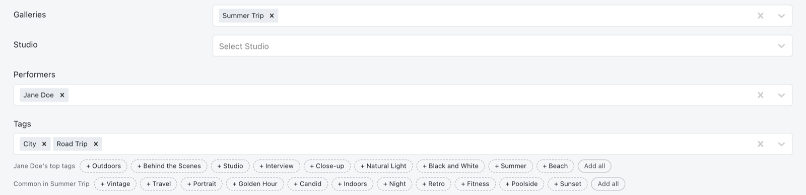
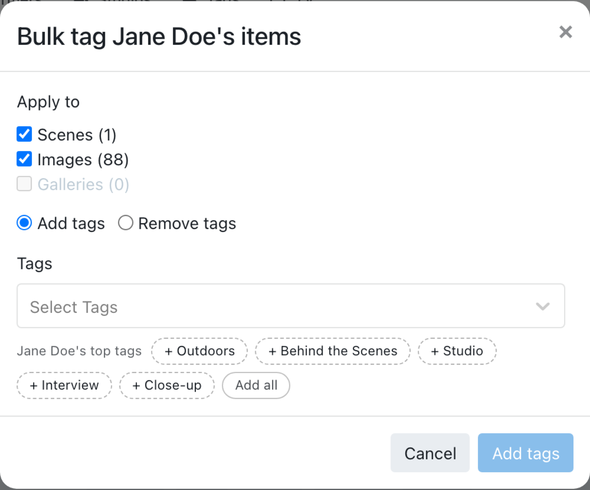
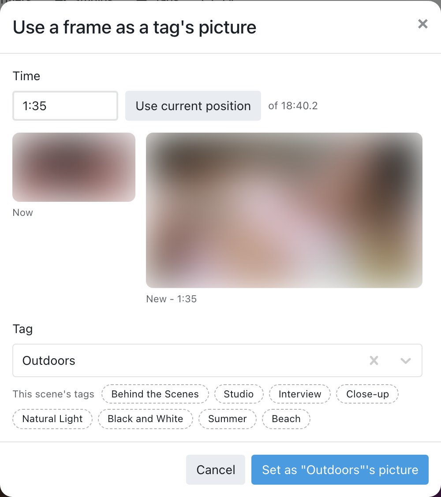

# Better Tagging Tools

Tags each performer and studio with the tags used most often on their scenes, images and
galleries (and each gallery with its photos' most used tags), then suggests tags while you edit. It also adds bulk tagging to performer and
gallery pages, can tag a gallery's photos with the gallery's name, can give tags without
a picture one from your library, keeps tag names consistently capitalised, auto tags from file
names in more places than Stash does, fills in dates and titles from file names, suggests title ideas,
and gives scenes a studio from the account link in their file name.

No AI is involved. For AI tags, AI titles and reading watermarks, add the
[Better Tagging AI Add-on](../BetterTaggingAI): its buttons and tasks sit next to these.

*Editing a photo: one click adds a suggested tag. (Shown with example names and tags.)*

## Suggested tags

Under the **Tags** box when you edit a scene, image or gallery:

The first row comes from the first of these the item has:

| The item has… | You see |
| --- | --- |
| Tags | **Goes with [tag]**: the tags most often found together with the ones it already has |
| A gallery | **Common in [gallery]**: the tags used most on that gallery's photos |
| Performers | **Common on [Name]'s scenes** (or images, galleries): the tags used most on that performer's items |
| A studio | **Common on [Studio]'s scenes** (or images, galleries): the tags used most on that studio's items |
| None of these | **Most used scene tags** (or image tags, …) across your library |

If one finds nothing new to suggest, the next one is used. With performers picked, **[Name]'s top
tags** is shown as well.

- **Goes with** looks at every item of the same kind (scenes on a scene, images on an image, and so on)
  that has *all* the tags already chosen, and suggests the other tags those items have most often.
  With one tag it uses everything with that tag. If no other item has all of them, it uses items with
  any of them instead (**Often with these tags**). Hover over a tag to see how many items it's on.
- The performer row works the same way: items with all the picked performers, else any of them.
  Once you add a tag, **Goes with** takes over.
- Click a tag to add it, or **Add all**. They go into the form like any other tag, so you still press **Save**.
- The rows update as soon as you change the tags, galleries, performers or studio in the form. Adding a
  suggested tag narrows the next suggestions.
- Tags already on the item aren't suggested.

## Top tags for performers, studios and galleries

The **Tag performers with their top tags** task counts the tags on every performer's scenes,
images and galleries and adds their most used ones (10 by default) to the performer.
**Tag studios with their top tags** does the same for studios, and **Tag galleries with their top
tags** gives each gallery the most used tags of its photos (gallery-name tags never count).

- After that, whenever you save a change to the tags or performers of a scene, image or gallery,
  the performers in it are recounted. Batch edits are handled once at the end, in a background job.
  Turn on **Refresh studios' top tags on edit** and **Refresh galleries' top tags on edit** to keep
  studios and galleries up to date the same way.
- Tags the plugin added are taken off again when they drop out of the top list.
  **Tags you added yourself are never removed.**
- **Preview top tags** writes what the three tasks would change to the log without changing anything.

## Bulk tagging

- **Performer pages:** a **Bulk tag scenes, images & galleries…** button adds (or removes) tags on everything that performer is in.
- **Gallery pages:** the tags button in the image toolbar (also in its **…** menu) tags every photo in the gallery, just the ones you've selected, and/or the gallery itself.
- The performer's top tags are suggested in the window, and you can create new tags there.
- It runs as a background job, so you can follow it under **Settings → Tasks**.

## Gallery-name tags

Turn on **Tag gallery images with the gallery's name** and every photo in a gallery gets a tag
named after it (its title, or the zip or folder name). New galleries, renamed ones, scanned
photos and photos you move into a gallery are kept up to date. Run the **Tag gallery images with
the gallery's name** task once for the galleries you already have.

- An existing tag with the same name is reused.
- The gallery's studio is left out of the name ("[Studio] Beach Day" → "Beach Day"), unless the name is only the studio. Image titles made from gallery names do the same.
- Renaming a gallery swaps its photos over to the new name's tag.
- These tags never count towards performers' top tags or "most used" suggestions.
- Photos added from a gallery's **Add** tab don't trigger anything in Stash, so re-run the task to pick those up.

## A gallery's tags, performers and studio on its images

Gives every image in a gallery the gallery's **tags** and **performers**, and its **studio** if the
image has none yet.

- **One gallery:** **Tag images with this gallery's tags, performers & studio** in the **…** menu of
  the gallery's image list (or the gallery's **⋮** menu).
- **Several:** select them in the Galleries list and use **Tag images with their gallery's tags,
  performers & studio** in its **…** menu.
- **Every gallery:** the task **Tag gallery images with the gallery's tags, performers and studio**,
  with **Preview gallery tags, performers and studio on images** to check first.
- It only adds: nothing is taken off, and a studio an image already has is kept.
- Tags this plugin added to a gallery as its top tags (counted from its images) aren't copied back
  down, or a tag on a few images would spread to all of them.
- Galleries tagged as sexual content involving minors are skipped.
- It runs as a background job; follow it under **Settings → Tasks**.

## Tag pictures

The **Give tags without a picture one from your library** task gives every tag without a picture
the photo that's most "about" that tag (the one with the fewest other tags, then the highest
rated). If there's no photo, it uses a scene screenshot, then a marker or gallery cover. Turn
on **Give tags a picture automatically** to do the same whenever a tag without a picture gets used.
Tags that already have a picture are never changed.

Every tag gets a picture of its own where possible. Related tags often share their best photo, so
the plugin compares each candidate with the pictures other tags already have and moves on to the
next one if it's taken. The rarest tags pick first, since they have the fewest pictures to choose
from. When a tag only appears on scenes that lots of other tags share, it takes a different frame
from one of those videos instead (using Stash's own ffmpeg).

### Don't like a tag's picture?

On the **Tags** page, select one or more tags and choose **••• → Pick a new picture**. Each one
gets its next-best picture by the same rules (never one another tag has), and the cards update
straight away. Press it again for another; it remembers a tag's recent pictures, and cycles back
through them once there's nothing new left.

### From a scene

On a scene's page, **⋮ → Use a frame as a tag's picture…** (next to Stash's own thumbnail
options) lets you pick any moment of the video as a tag's picture:

1. It opens at the player's current position. Type a time instead (`1:23`, `1:02:03` or `83.5`), or scrub the video and press **Use current position**.
2. Choose the tag: one of this scene's tags with one click, or any tag from the picker.
3. Compare the tag's current picture with the new frame, then press **Set**.

The frame is taken from the video file at full quality (using Stash's own ffmpeg), so typing a
time doesn't move the video you're watching.

### Pictures for tags that share one

Already have tags sharing a picture? **Give tags that share a picture their own** fixes them: in
each group the rarest tag keeps the picture and the others get a new one. The first run compares
every tag's picture once, which can take a few minutes.

### A fresh picture for every tag

**Give every tag a new picture (replaces existing ones)** gives *every* tag a different picture
from the one it has now, picked the same way (unique, rarest tags first). This includes pictures
you set yourself, and the old ones can't be brought back, so make a backup first
(**Settings → Tasks → Backup**). A tag with no other picture available keeps the one it has.

## Auto tag

Stash's **Auto Tag** adds performers, studios and tags whose names appear in a file's path. This plugin
uses it in three more places:

- **New performers, studios and tags** (setting **Auto tag new performers, studios and tags**): when
  one is created, by hand, by a scraper or by another plugin, Stash's Auto Tag runs for just that one
  across your library. No need to remember to run the whole task.
- **Auto tag this (from file name)** in the ⋮ menu of a scene, image or gallery page (a gallery: the
  gallery and its images), and **Auto tag selected (from file names)** in the ••• menu of the scene, image
  and gallery lists. Stash's own task can only be pointed at whole folders; these do exactly the items
  you pick, and also work on organized items.
- **With the [AI add-on](../BetterTaggingAI)**: before the AI looks at an item, it gets its file-name
  matches first, so the AI only adds what the file name doesn't already say.

The matching is the same as Stash's: the name, ignoring case, as a whole word anywhere in the path
(folders included), with spaces in the name also matching `.`, `-`, `_` or nothing. Studios and tags
also match by their aliases. A studio is only set when the item has none. Anything marked
**Ignore Auto Tag** is skipped. So are the plugin's gallery-name tags.

> Short, everyday tag names (like a tag called "Me") match a lot of file names. Turn on
> **Ignore Auto Tag** on such tags (edit the tag) to keep them out.

## Studios from accounts

Many downloaded clips name the account they come from in the file name or link. **Studios from
accounts: from file names and links only** gives scenes **without a studio** a studio for the
`onlyfans.com/…`, `fansly.com/…`, `instagram.com/…` or `tiktok.com/@…` account in their file name,
title, details or URLs:

- An existing studio with that name, alias or profile link is used; otherwise a new one is made,
  with the profile link, under a parent studio for the platform (**OnlyFans**, **Fansly**,
  **Instagram** or **TikTok**, made if needed). A scene that already has a studio is never changed.
- An account name that matches a performer's name or alias (ignoring case, spaces and dots, so
  `janedoe` matches *Jane Doe*) or one of their profile links adds that performer to the scene.

The [AI add-on](../BetterTaggingAI) can also read the account from the watermark in the video.

## Dates from file names

Scenes, images and galleries without a date can get the one in their file name, or in the name of
the folder they're in:

| File name | Date |
| --- | --- |
| `2023-05-19_video_0042.m4v`, `IMG-20121202-00362.jpg` | 2023-05-19, 2012-12-02 |
| `Studio - 6 Nov 2026 - Title.mp4`, `Name 17 may 2026 title.mp4` | 2026-11-06, 2026-05-17 |
| `Studio - November 6th, 2025 - Title.mp4` | 2025-11-06 |
| `Studio.21.07.08.Name.XXX.1080p.mp4` (scene release names) | 2021-07-08 |
| `05-27-2014 17_26_15.jpg`, `ScreenRecording_05-19-2025 …` | 2014-05-27, 2025-05-19 |

Only full dates count, so a lone year (`1998_IMG_0004`) or a month (`01-January`) is ignored, and so
are dates in the future. When it can't tell the day from the month (`05-06-2014`), the file is left alone.
A date you've already set is never changed.

- **Fill in dates from file names** (task), with **Preview dates from file names** to check first.
- **Fill in dates of new scenes, images and galleries** (setting): new items from a scan get their date.
- **Auto tag this / Auto tag selected** (and the AI add-on) fill in empty dates too.

## Titles from file names

Scenes, images and galleries without a title can get one made from their file name, cleaned up:

| File name | Title |
| --- | --- |
| `Jane Doe - 6 Nov 2026 - Beach Day [11166].mp4` | Beach Day |
| `the haunted house animation 4K.mp4` | The Haunted House Animation |
| `Studio.21.07.08.Garden.Party.XXX.1080p.mp4` | Garden Party |
| `SummerRoadTrip12_hd.png`, `it_s a trap.jpg` | Summer Road Trip 12, It's a Trap |
| `IMG_3885.MP4`, `RPReplay_Final1571040512.mp4`, `FullSizeRender.MOV` | *(none)* |
| `F61E88AC-CF2C-4A72-….mp4`, `v12044gd0000cj7f7….mp4`, `XplFXgK.jpg` | *(none)* |

- Taken out: `[ids]` and `[site names]`, `(1)`, dates (they go in the date field), resolutions and
  codecs (`1080p`, `4K`, `HEVC`), download-site names, and a performer's or studio's name when
  it's its own `-` part or starts the name. Turn on **Keep performer and studio names in titles**
  to keep names (`Jane Doe - Beach Day`); a name repeated as its own part is still only kept once.
- Underscores and dots become spaces, and `CamelCaseNames` and `name12` are split up. All-lowercase
  or ALL-CAPS names are capitalised like tags (using **Special spellings**).
- Names that are only a camera or app name (`IMG_…`, screen recordings, `FullSizeRender`), a random
  id (UUIDs, hashes, TikTok-style ids) or a performer's name get no title from it. A title you've
  already set is never changed.
- An **image** whose file name makes no title gets one from its **gallery** instead: the gallery's
  name and the image's place in it (in path order), e.g. `Beach Trip #12`; a zip's `.zip` / `.cbz`
  is left off. In several galleries, the zip or folder gallery is used first, else the smallest.
  Turn on **Don't title images after their gallery** to leave such images without a title.
- **Fill in titles from file names** (task), with **Preview titles from file names** to check first.
- **Fill in titles of new scenes, images and galleries** (setting): new items from a scan get a title.
- **Redo titles made from file names** (task): after changing **Keep performer and studio names in
  titles**, makes the titles this plugin set again with the new setting. Titles you typed or scraped
  are left alone.
- **Auto tag this / Auto tag selected** (and the AI add-on) fill in empty titles too.

## Title ideas

When you edit a scene, image or gallery, a **Title ideas** row under the **Title** box suggests
titles. Click one to put it in the box, then edit it if you like and press **Save**.

- **From its details:** the title from its file name (with and without performer names), and
  titles put together from its performers, studio, date and most telling tags (the rarest ones,
  or the performers' top tags if it has none yet), e.g. `Jane Doe - Beach, Sunset & Picnic`.
- With the [AI add-on](../BetterTaggingAI), an **AI titles** row below it has an **Ask AI for titles**
  button.

## Tag names

Keeps tag names capitalised the same way: `dating app` becomes `Dating App`, while small words
stay lowercase in the middle of a name (`behind the scenes` → `Behind the Scenes`).

- **Preview tag name capitalisation**: lists the renames in the log without changing anything. Run this first.
- **Capitalise tag names**: renames every tag that needs it.
- Turn on **Capitalise new tags automatically** to capitalise tags as soon as they're created (from the tag picker, a scraper, another plugin…).

| Before | After | Why |
| --- | --- | --- |
| `soft spoken` | `Soft Spoken` | Each word gets a capital. |
| `in the shower` | `In the Shower` | `a, an, and, as, at, but, by, for, from, in, into, nor, of, on, onto, or, per, the, to, via, vs, with` stay lowercase in the middle. |
| `T-shirt` | `T-shirt` | Hyphenated words count as one word. |
| `POV`, `McKenzie` | unchanged | Capitals already there are never lowered. |
| `3rd person` | `3rd Person` | Words starting with a number are left alone. |
| `cnn` | `CNN` | With `CNN` in **Special spellings**. |

Stash treats tag names that differ only in case as the same tag, so renaming never creates duplicates.

## Tasks

Under **Settings → Tasks → Plugin Tasks → Better Tagging Tools** the tasks are grouped into
sections you can open and close: **Top tags**, **Titles**, **Studios from accounts**, **Dates**, **Tag pictures**
and **Tidy up tags** (capitalisation, gallery-name tags, and a gallery's tags, performers and studio
on its images). Each section starts with its preview task, which only writes to the log.

## Settings

Under **Settings → Plugins → Better Tagging Tools**:

| Setting | What it does |
| --- | --- |
| Top tags per performer, studio or gallery | How many tags to add to each. Default 10. |
| Minimum uses | A tag must be on at least this many of the performer's, studio's or gallery's items. Default 3. |
| Don't count images | Count only scenes and galleries for performers and studios. |
| Tags to ignore | Comma-separated tags never added as top tags, e.g. `Organized, To Review`. Doesn't affect Auto Tag. |
| Don't refresh on edit | Only update top tags when you run the tasks. |
| Refresh studios' top tags on edit | Recount a studio when tags or the studio change on its scenes, images or galleries. |
| Refresh galleries' top tags on edit | Recount a gallery when its photos' tags change or photos move into it. |
| Tag gallery images with the gallery's name | See above. |
| Parent tag for gallery-name tags | Optional; files the gallery-name tags under one tag, e.g. `Galleries`. |
| Give tags a picture automatically | See above. |
| Capitalise new tags automatically | See "Tag names" above. |
| Auto tag new performers, studios and tags | See "Auto tag" above. |
| Fill in dates of new scenes, images and galleries | See "Dates from file names" above. |
| Fill in titles of new scenes, images and galleries | See "Titles from file names" above. |
| Don't title images after their gallery | Leave images whose file name makes no title without one, instead of `Gallery name #12`. |
| Keep performer and studio names in titles | Leave names in titles made from file names. |
| Special spellings | Comma-separated words or tag names to always write exactly as given when capitalising, e.g. `CNN, POV, HD, iPhone`. |
| Suggested tags to show | The most suggestions per row. Default 15. |

## Requirements and notes

- Python 3 (standard library only). Tested with Stash v0.31.
- ffmpeg, only for video frames when giving tags a picture. It uses the one Stash uses; the official
  Docker image includes it.
- The code is in `btt_core.py`, which the AI add-on ships too (the same file), so each plugin works
  on its own.
- Changes are listed in the [changelog](CHANGELOG.md).
- The plugin keeps a few small files in its own folder (which tags it added, a short work queue). Deleting them is safe; it just forgets which performer tags it added.
- Works with any theme.
