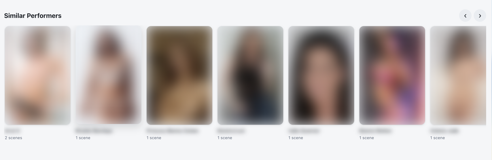

# Modern UI

A cleaner, app-like look for Stash, built to feel good on a phone as well as a computer.

*The top bar and the list toolbar on a computer, in the dark theme: everything sits on rounded, frosted panels with the filters, sort and view buttons grouped together.*

| Dark theme | Light theme |
| --- | --- |
|  |  |

*The home page on a computer in both themes. Rows run edge to edge with round scroll arrows. (Pictures are blurred with the [Privacy Blur](../PrivacyBlur) plugin.)*

### On a phone

   

*The tab bar at the bottom of the screen, and the **More** sheet with the rest of the pages. Tap **Edit tab bar** to choose which pages sit on the bar.*

## Features

**Look and feel**
- Cleaner scene, performer, image, gallery, studio, group and tag cards.
- Dark, light, or auto (follows your device) colour themes.
- Home page rows run edge to edge with round scroll arrows.

**Phones**
- App-style tab bar at the bottom of the screen. Pick and reorder its tabs from **More → Edit tab bar**. Pages added by other plugins (e.g. stash-tv) can go on it too.
- Press and hold a card to select it, then tap others to select several for bulk editing.
- Swipe left and right between images on an image's page.

**Scenes**
- On wide screens, details sit under the video instead of in a side panel, with the studio logo beside the title.
- **Suggested**: scored by shared tags, same studio, look-alike performers, length and orientation, best match first.
- **More with [performer]**: other scenes with the same performers.
- **Similar Performers**: performers who look like the ones in the scene.
- These rows are hidden while the **Edit** tab is open, so they don't get mixed in with the edit form.

**Images and galleries**
- Image details (title, rating, tabs) sit under the picture on wide screens, like scenes. You can change this in the settings.
- **Similar photos**: scored by shared tags and galleries (2 points each) and look-alike performers (up to 5). Photos of the same performer are left out, since they have their own row. If there aren't enough matches, it fills up with unorganised photos, then random ones.
- **More from [gallery]** when you came from a gallery, or **More from [row]** when you came from a home page row, using that row's own filter. It shows the 2 photos before this one, this one, then the ones after it.
- **More with [performer]**: other photos with the same performers.
- Each of these is a scrolling row with a **Load more** card at the end.
- Gallery pages show the gallery's name at the top. The details panel starts closed; you can change this in the settings.

**Performers**
- **Similar Performers** row, scored by shared tags, ethnicity, hair and eye colour, country, height and age.

*The Similar Performers row in the light theme, with names blurred by Privacy Blur.*

**Tags**
- A–Z index view: a new button next to the grid/list buttons on the Tags page. It only lists tags that are used on at least one scene or image.

*The A–Z view (shown with example tags): tap a letter in the bar to jump to it, or type in the search box to narrow the list.*

## Settings

Under **Settings → Plugins → Modern UI**:

| Setting | What it does |
| --- | --- |
| Colour theme | `dark` (default), `light` or `auto`. |
| Show card details | Bring back dates, descriptions, file paths, performer age/country and image titles on cards. |
| Show count buttons | Bring back the tag/performer/scene/marker/O-count buttons on cards. |
| Show rating banner | Bring back the rating ribbon on card pictures. |
| Hide titles | Pictures only, no titles, on every card. |
| Show whole pictures | Fit the whole picture inside image and gallery cards instead of cropping. |
| Image and gallery card shape | `portrait` (default), `square`, `landscape` or `wide`. |
| Cards per row on phones | `1` or `2` (default). Image grids show one extra. |
| Scene details beside the video | Keep Stash's side panel on scene pages on wide screens. |
| Image details beside the picture | Keep Stash's side panel on image pages on wide screens. |
| Open gallery details panel by default | Start gallery pages with the details panel open. |
| Disable mobile tweaks | Turn off the phone layout. |
| Disable swiping between images | Turn off swipe / arrow-key navigation on image pages. |
| Disable bottom tab bar on phones | Turn off the tab bar. |
| Bottom tab bar pages / More panel order | Set from the phone via **More → Edit tab bar**. |

## Optional: login page

Stash's login page doesn't load plugins, so its styling can't come from this plugin.
To give it a matching look, copy
[`extras/login.css`](https://github.com/OpenSourceLuffy/stash-plugins/blob/main/extras/login.css)
into **Settings → Interface → Custom CSS** and tick **Custom CSS enabled**.

## Notes

- Tested with Stash v0.31. Other themes or CSS plugins may clash with it, so turn those off if something looks wrong.
- The Suggested and Similar rows use Stash's own data and run in your browser after the page loads. Nothing is sent anywhere else.
