# Modern UI

A cleaner, app-like look for Stash, built to feel good on a phone as well as a computer.

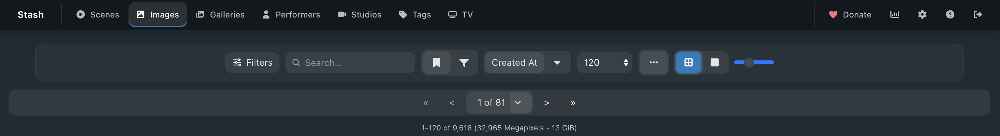

*The top bar and the list toolbar on a computer, in the dark theme: everything sits on rounded, frosted panels with the filters, sort and view buttons grouped together.*

| Dark theme | Light theme |
| --- | --- |
| 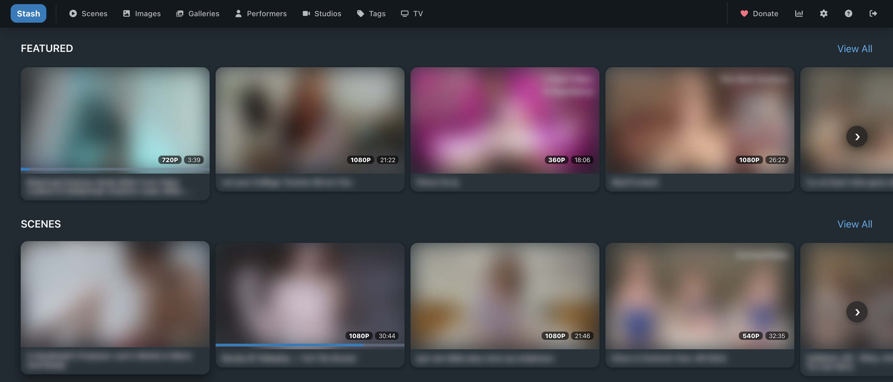 | 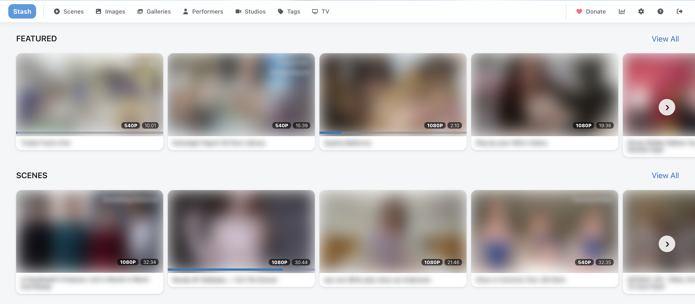 |

*The home page on a computer in both themes. Rows run edge to edge with round scroll arrows. (Pictures are blurred with the [Privacy Blur](../PrivacyBlur) plugin.)*

### On a phone

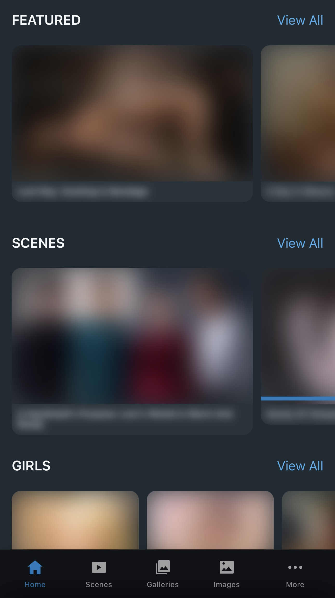 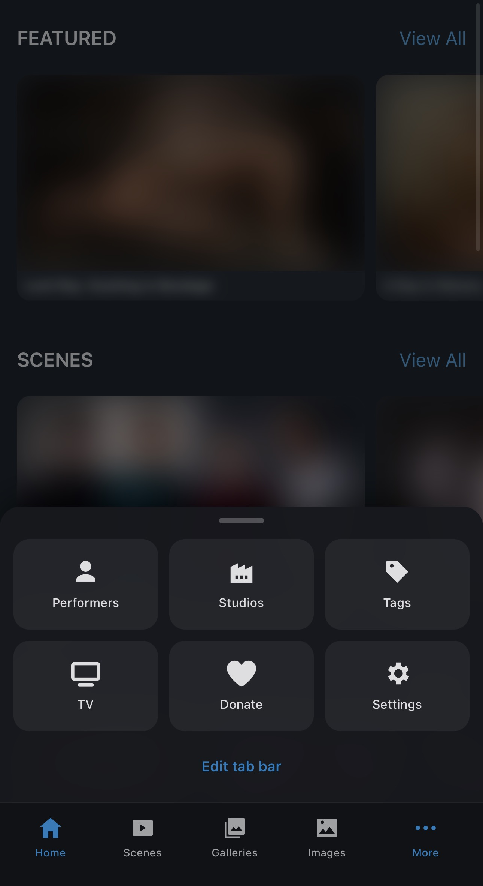 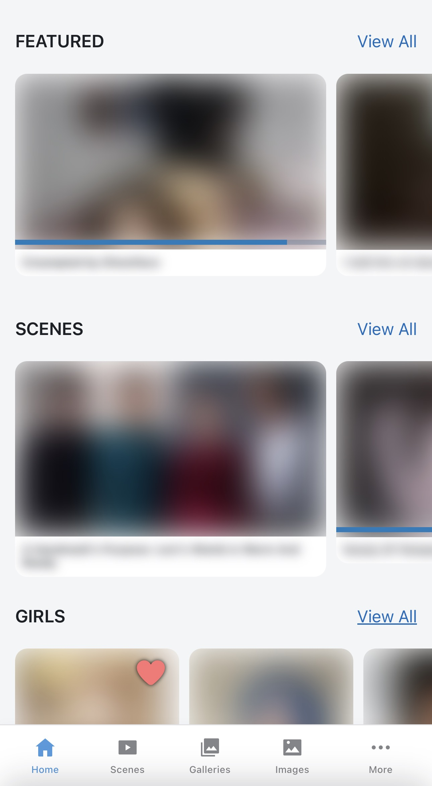 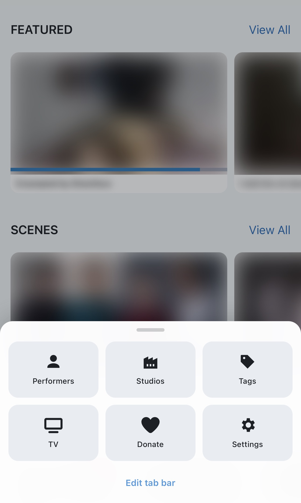

*The tab bar at the bottom of the screen, and the **More** sheet with the rest of the pages. Tap **Edit tab bar** to choose which pages sit on the bar.*

## Features

**Look and feel**
- Cleaner scene, performer, image, gallery, studio, group and tag cards.
- Dark, light, or auto (follows your device) colour themes.
- Home page rows run edge to edge with round scroll arrows.
- On an image's page, click the picture to see it full screen. Zoom in with the mouse wheel, a
  trackpad or two-finger pinch, or a double-click / double-tap, and drag to move around. Click
  outside the picture, press Esc or tap **Close** to go back.

**Phones**
- App-style tab bar at the bottom of the screen. Pick and reorder its tabs from **More → Edit tab bar**. Pages added by other plugins (e.g. stash-tv) can go on it too.
- Press and hold a card to select it, then tap others to select several for bulk editing.
- Swipe left and right between images on an image's page.

**Scenes**
- On wide screens, details sit under the video instead of in a side panel, with the studio logo beside the title.

**Images and galleries**
- Image details (title, rating, tabs) sit under the picture on wide screens, like scenes. You can change this in the settings.
- Gallery pages show the gallery's name at the top. The details panel starts closed; you can change this in the settings.

**Suggested and Similar rows**
- The "Suggested", "Similar photos", "More with…" and "Similar Performers" rows now live in their own plugin, [Stash Suggestions](../StashSuggestions), which also works without Modern UI. Install it alongside Modern UI to keep them; they pick up Modern UI's look, and swiping between photos follows the row you picked from.

**Sorting**
- A **Count** option in the Sort menu on the Tags, Performers and Studios pages: scenes + images + galleries added together, highest first (flip the arrow for lowest first). Paging, filters and search work as usual. Stash can't sort by a total itself, so Modern UI works out the order in your browser.

**Tags**
- Tag cards look like gallery cards: the tag's picture fills the card, with the name underneath. Tags without a picture show a small tag icon instead. (The [Better Tagging Tools](../BetterTaggingTools) plugin can give your tags pictures from your library.)

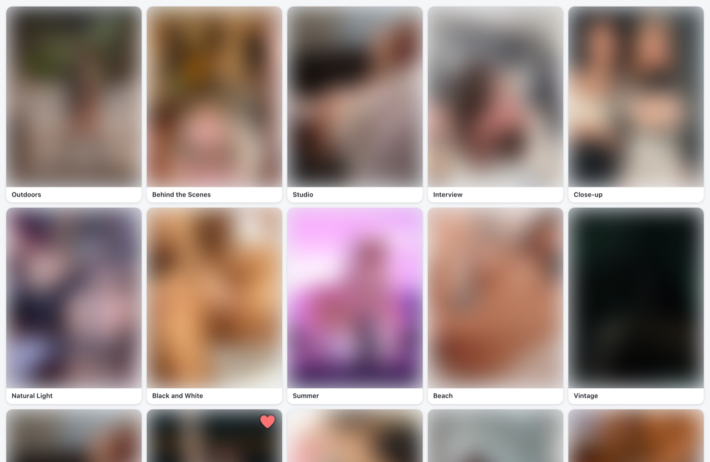

*Tag cards in the light theme (pictures blurred with Privacy Blur, example tag names).*

- A–Z index view: a new button next to the grid/list buttons on the Tags page. It only lists tags that are used on at least one scene or image.

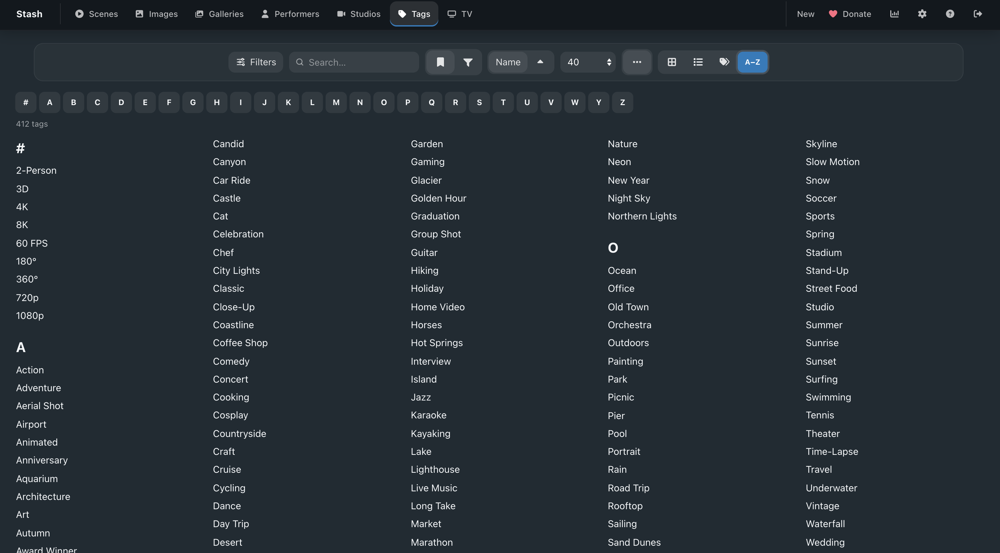

*The A–Z view (shown with example tags): tap a letter in the bar to jump to it, or type in the search box to narrow the list.*

## Settings

Under **Settings → Plugins → Modern UI**:

| Setting | What it does |
| --- | --- |
| Colour theme | `dark` (default), `light` or `auto`. |
| Show card details | Bring back dates, descriptions, file paths, performer age/country and image titles on cards. |
| Show count buttons | Bring back the tag/performer/scene/marker/O-count buttons on cards. |
| Show rating banner | Bring back the rating ribbon on card pictures. |
| Hide titles | Pictures only, no titles, on every card. |
| Show whole pictures | Fit the whole picture inside image, gallery and tag cards instead of cropping. |
| Image and gallery card shape | `portrait` (default), `square`, `landscape` or `wide`. |
| Cards per row on phones | `1` or `2` (default). Image grids show one extra. |
| Scene details beside the video | Keep Stash's side panel on scene pages on wide screens. |
| Image details beside the picture | Keep Stash's side panel on image pages on wide screens. |
| Open gallery details panel by default | Start gallery pages with the details panel open. |
| Disable mobile tweaks | Turn off the phone layout. |
| Disable swiping between images | Turn off swipe / arrow-key navigation on image pages. |
| Disable bottom tab bar on phones | Turn off the tab bar. |
| Bottom tab bar pages / More panel order | Set from the phone via **More → Edit tab bar**. |

## Optional: login page

Stash's login page doesn't load plugins, so its styling can't come from this plugin.
To give it a matching look, copy
[`extras/login.css`](https://github.com/OpenSourceLuffy/stash-plugins/blob/main/extras/login.css)
into **Settings → Interface → Custom CSS** and tick **Custom CSS enabled**.

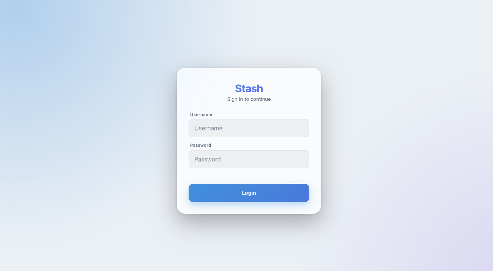 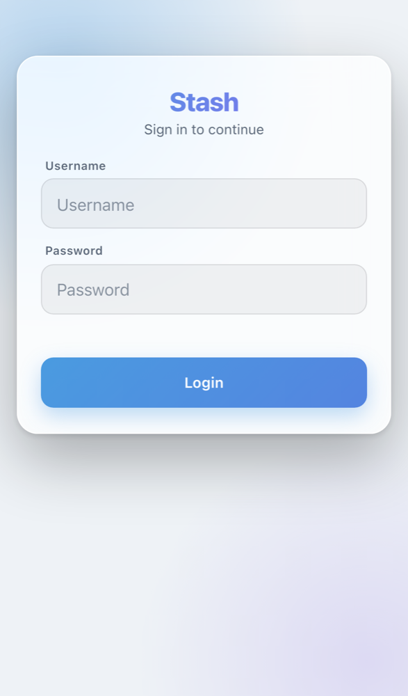

On phones the sign-in box sits near the top of the screen, so it stays in view when the keyboard opens.

## Notes

- Tested with Stash v0.31. Other themes or CSS plugins may clash with it, so turn those off if something looks wrong.
- Upgrading from 0.48 or earlier: the Suggested / Similar rows moved to [Stash Suggestions](../StashSuggestions). Install it to keep them.
