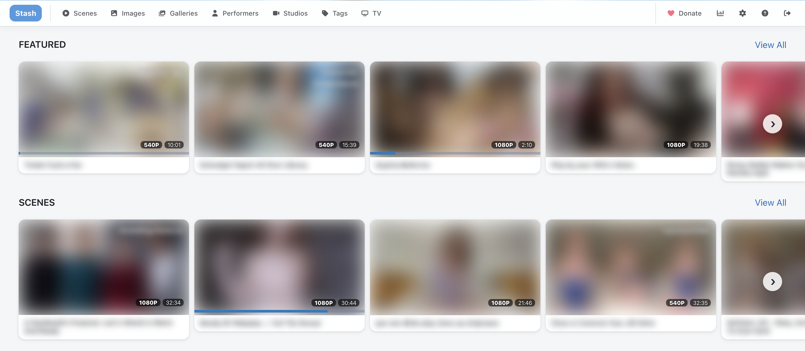
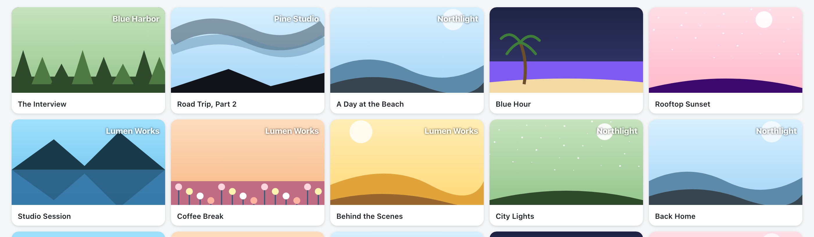
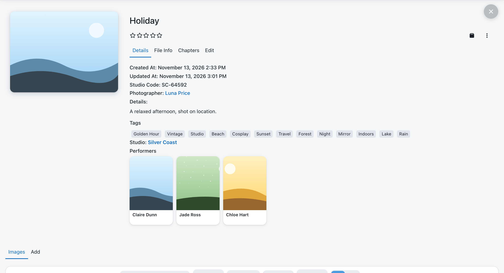
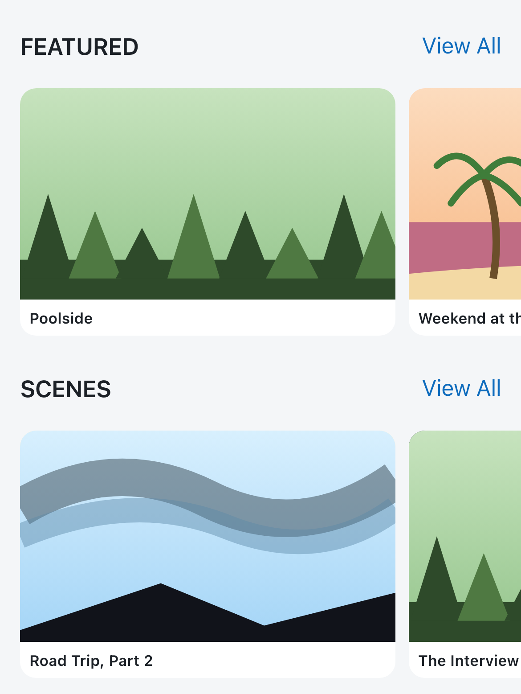

# Privacy Blur

One switch blurs every cover, thumbnail, photo and video in Stash - or swaps them for safe stand-in pictures and made-up names - and flipping it back brings them back.
Use it to take screenshots you can share, or to browse your library when other people are around.

*Stash's home page with the blur on, and performer/studio names and titles blurred too.*

## Using it

- Go to **Settings → Plugins → Privacy Blur** and turn on **Blur on**. It takes effect straight away.
- Or press **Shift + Alt + B** (Shift + Option + B on a Mac) on any page to flip the same switch.
- Or, anywhere in **Settings**, tap the floating **Blur is on / Blur is off** button in the bottom right
  (it only shows on Settings pages, so it's never on screen while you browse).

The setting is saved in Stash, not in your browser, so turning it on blurs Stash on every device you
use until you turn it off.

It only changes what's shown on your screen. Nothing in your library is changed.

## What gets blurred

- Scene, image, gallery, group, studio and performer pictures everywhere: cards, walls, pages, the video player and its preview strips.
- Optionally, **performer and studio names** and **titles / file names** (see settings).
- Optionally, **tags**.
- When names or titles are hidden, the browser tab title becomes just "Stash" too.

## Replace instead of blurring

| A gallery page | On a phone |
| --- | --- |
|  |  |

*Replace mode on a real library: every picture, name, title, tag and detail on screen is a stand-in.*

Turn on **Replace instead of blurring** and nothing is blurred: every picture and video shows a
simple drawn stand-in instead (landscapes, sunsets, a skyline, a beach, a forest... 24 in all, in
different colours), and, with the **Also hide** switches on, performer and studio names, titles,
gallery names, tags and details text show made-up ones ("Jane Doe", "Northlight", "Golden Hour",
"Beach"). The page looks like an ordinary, safe library rather than a blurred one.

- The same item always gets the same stand-in, and two different names don't share one, so a page
  still makes sense (a performer keeps one name across pages).
- Videos show a stand-in over the player; its controls still work.
- Numbers, dates and counts stay as they are. Only the screen changes, and turning it off (or
  turning off Replace) puts the real pictures and names back straight away.
- The stand-in pictures are drawn by the plugin itself, so nothing is downloaded.

## Settings

Under **Settings → Plugins → Privacy Blur**:

| Setting | What it does |
| --- | --- |
| Blur on | Turns the blur on or off. |
| Blur strength | 4 (light) to 40 (very strong). Default 18. |
| Replace instead of blurring | Show safe stand-in pictures and made-up names instead of a blur (see above). |
| Also hide performer and studio names | Blur (or replace) names on performer cards, performer pages and suggestion rows, and the studio name in the corner of each card. |
| Also hide titles | Blur (or replace) scene, image, gallery and group titles and file names (and, when replacing, details text). |
| Also hide tags | Blur (or replace) tag names. |
| Peek on hover | On a computer, un-blur a picture while the mouse is over it. Turn it off for screenshots. |

Changes apply as soon as you flip a switch; no reload needed.

## Notes

- Works on its own or alongside Modern UI and Stash Suggestions (names and titles in its Suggested / Similar rows are blurred too).
- Some other themes or plugins may show pictures in ways it doesn't catch. If something isn't
  blurred, please open an issue with the page it was on.
- Changes are listed in the [changelog](CHANGELOG.md).
