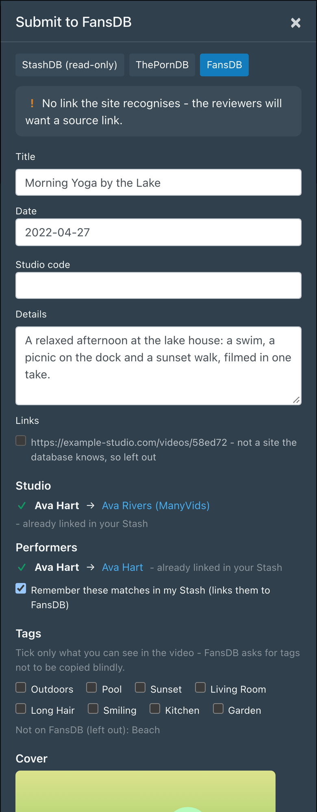
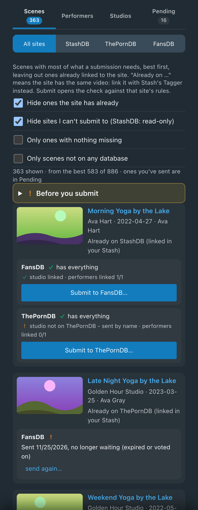
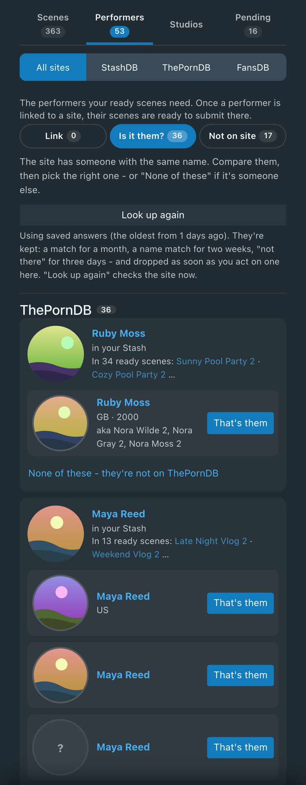
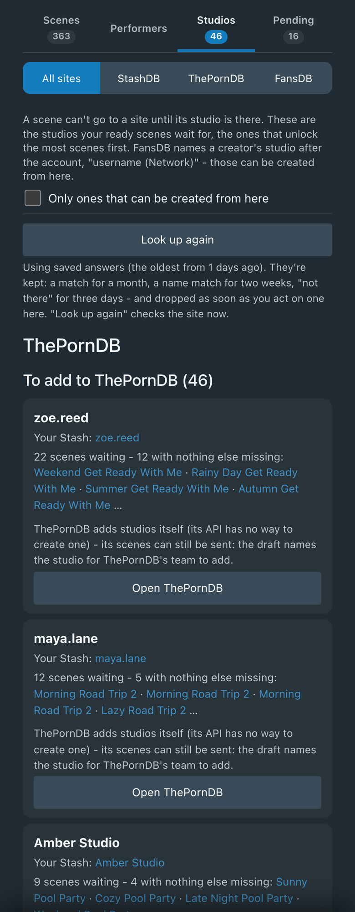
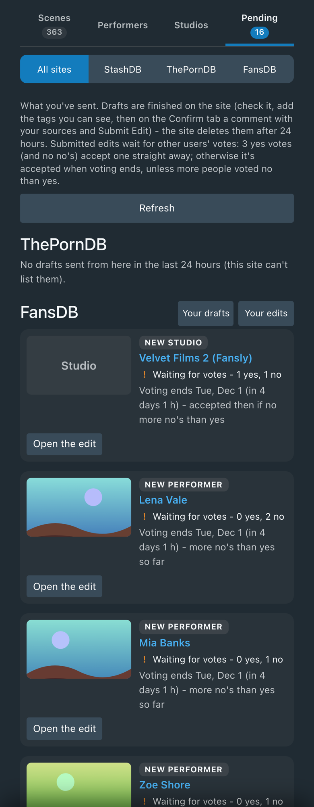

# Stash-Box Submit

Adds **Submit to FansDB / StashDB…** to a scene's ⋮ menu. It checks the scene against that site's
own submission guidelines, links its performers, studio and tags to the site's existing entries, and
sends it as a **draft**. You then finish the draft on the site.

Stash's own **Submit to Stash-Box** sends the scene as it is. Performers, studios and tags that
aren't already linked to the site in your Stash arrive as new, unknown entries, and you have to fix
each one on the site. This plugin finds them first.

## What it checks

From each site's guidelines ([FansDB](https://docs.fansdb.cc/scenes/),
[StashDB](https://guidelines.stashdb.org/docs/scenes/)):

- **Your account:** whether it can submit edits there. A read-only account is told how to ask for
  edit rights.
- **What the site accepts:** StashDB doesn't take OnlyFans, Fansly, Patreon or JustFor.Fans content;
  FansDB is the place for those.
- **Fingerprint:** the video needs its fingerprint (phash) before it can be submitted. If it's
  missing, run Stash's Generate task with **Perceptual hashes** on.
- **Duplicates:** scenes on the site with the same fingerprint are listed, so you can check before
  adding one again.
- **Title, date, details and links:**
  - the title is kept to one line, with emojis fine and decorative Unicode lettering turned into
    plain letters;
  - the date must be `YYYY-MM-DD` (or just the month or year);
  - links are only sent if the site knows that website.
- **Studio and performers:** each one is matched to the site's entry, in this order:
  1. already linked in your Stash;
  2. the same link, such as their OnlyFans page;
  3. the same name or alias, which you confirm from a list.

  If one isn't on the site yet, the window says so.
- **Adding a performer:** for a performer the site doesn't have, the window shows what their draft
  would hold, following FansDB's rules:
  - their main name;
  - their gender (required);
  - aliases: usernames from their content-platform accounts plus your aliases, never social media
    usernames;
  - their account links (at least one is required) and their picture.

  Anything still missing is flagged. When the video came from an account whose link they don't have
  in your Stash (such as `onlyfans.com/username`), one click adds it there. **Send … draft** sends a
  private draft you finish on the site; once it's approved, check the scene again to link them.
- **The right studio account:** FansDB wants the studio to be the account the video was posted
  from. If the scene's post link is from a different account than its studio in your Stash (for
  example, posted on OnlyFans while the studio is the creator's Fansly account), it says so and uses
  that account's studio. Your Stash isn't changed.
- **Adding a studio on FansDB:** when the scene's studio is a creator's account (for example, it has
  their OnlyFans link), the window proposes it the way FansDB names accounts: `username (OnlyFans)`,
  under the **OnlyFans (network)** studio, with the account link and an edit comment.
  **Submit studio to FansDB** sends it as a **public edit** under your account, which FansDB users
  vote on. If it's accepted straight away it's linked; otherwise the scene draft names it, and you
  pick it on the draft page once it's approved. For other studios, **Add it on…** opens the site's
  form.
- **Tags:** your tags are matched to the site's own names and aliases, and none are ticked to start
  with. Both sites ask for tags you can see in the video, not ones copied from elsewhere. Tags the
  site doesn't have are left out.
- **Cover:** the scene's cover is sent, unless you untick it.

You can edit the title, date, studio code and details right in the window. **Send draft** stays off
until everything flagged is fixed.

## The Stash-Box Submit page

Open it from the **Ready to submit** button on the Scenes page (or the link under the task). It has
four sections, and under them a button per site - **All sites**, **FansDB**, **StashDB**,
**ThePornDB** - that filters whichever section is open:

- **Scenes** - the scenes ready to submit (below).
- **Performers** - the performers those scenes need on each site: found by a link (**Link in my
  Stash**, or **Link all found**), a name match to check (**That's them**), or not on the site
  (**Send performer draft**, or what to add first).
- **Studios** - the studios those scenes wait for, ones waiting for votes, and studios missing in your
  Stash (see **Studios to add** below).
- **Pending** - your drafts (with the time left) and your edits waiting for votes.

<table><tr>
<td></td>
<td></td>
<td></td>
<td></td>
</tr></table>

(The screenshots use made-up names and stand-in pictures.)

## Ready to submit

The task **Find scenes ready to submit** (Settings → Tasks) scores every scene for each site you've set
up, by what it has of what a submission needs:

- the video fingerprint, title, date, studio, performers and a link;
- whether its studio and performers are already linked to that site.

Then open the **Ready to submit** page, from the button on the Scenes page or the link under the
task. At the top, a **Before you submit** box lists what to watch for: drafts expire after
24 hours, bulk drafts have no tags, StashDB's limit for new contributors, fingerprint matches to
check, ThePornDB's basic checks, read-only accounts, and that submissions are public. Collapse it
once you've read it and it stays collapsed. Scenes come best first, with a row per site:

- **Has everything / missing …**, with a **Submit to …** button that opens the check above, set to
  that site.
- **Already on …:** the site has the same video, found by fingerprint. Link it with Stash's Tagger
  instead of adding it again.
- **Draft sent:** with a link to finish it on the site.

Which sites a scene is listed for:

- **FansDB:** creator and fan-site content (OnlyFans, Fansly, ManyVids…) only.
- **StashDB:** not OnlyFans, Fansly, Patreon or JustFor.Fans content, which it doesn't accept.
- **A site where your account is read-only:** it says so instead of offering to submit.
- **ThePornDB:** listed, but its guidelines couldn't be read and its API can't look up studios by
  link, tags or link sites. So its check is the basic one: fingerprint, duplicates, title, studio and
  performers.

**Check again** re-scores the list and checks the sites for duplicates. It takes about a minute on a
big library. The page keeps the best 300 scenes, plus the best 300 that no database has yet.

Settings (Settings → Plugins → Stash-Box Submit, both off by default):

- **Only scenes not on any database:** the page starts with that filter ticked, hiding scenes with
  an ID from any stash-box. You can tick or untick the filter on the page either way.
- **Allow sending drafts in bulk:** adds **Send drafts for ready scenes** for the site picked on the
  page. It sends up to 10 per click, after a confirmation, and only scenes whose check passes with
  nothing to decide: nothing missing, studio and performers matched by link or already linked, no
  fingerprint match on the site. They go with no tags. Anything needing a decision is skipped, and
  the report says why. Each draft still needs finishing on the site within 24 hours: tags, a comment
  with your sources (one is suggested to copy), then Submit Edit. StashDB's guidelines ask new
  contributors not to send 20+ edits at once.

## Studios to add (the Studios section)

A scene can't go to FansDB until its studio is there. The **Studios** section lists the studios your ready scenes wait for, the ones that unlock the most scenes first.
**Create on FansDB…** sends the studio the way FansDB's guidelines name it - "username (Network)",
under the network, with the account link - as a public edit under your account, only after you
confirm. When the plugin can't tell which account a studio is, add the account's link to the studio
in Stash, or use **Add on FansDB**.

The same page lists scenes already linked to FansDB that have no studio in your Stash (Stash's
Tagger only fills in studios you already have), with a button that creates the studio in Stash -
the username, under its network - or links the one you have, and sets it on those scenes.

## Submitting straight away

On FansDB (and StashDB once your account can edit) the plugin can submit the edit itself, as the
site's **Submit Edit** does, so there's no draft to finish:

- **Submit to FansDB…** in the check window, next to **Send draft** - you write (or keep) the edit
  comment, then it's sent. The studio and every performer must already be on the site.
- **Submit…** on performers under **Performers → Not on site**, and on drafts in **Pending** whose
  studio and performers are picked on the site.

Edits are public under your account and wait for other users' votes; they show in **Pending**. Use a
draft when you'd rather check everything on the site's own form first (its tag search, for one).
ThePornDB takes drafts only.

## After sending

The **Pending** section has, for each site, buttons to **Your drafts**
and **Your edits** there, and a **Review draft** button for each draft waiting, with the time left.
The check window and the bulk report show the same buttons once a draft is sent.

- **Open the draft** with the link the window gives you. Drafts are only visible to you, and the
  site deletes them after 24 hours unless you submit them.
- **Add a comment** on the site's **Confirm** tab saying where the details came from, then
  **Submit Edit**. The window suggests a comment you can copy.
- **Next time is quicker:** with **Remember these matches** on, the performers and studio you
  confirmed are linked to the site in your Stash.

## Needs

- Stash v0.31 and Python 3 (standard library only).
- The site set up in Stash with your API key, under **Settings → Metadata Providers → Stash-box
  Endpoints**.
- An account with edit rights on that site to submit the draft. You can make drafts without them,
  but you can't submit them.

Changes are listed in the [changelog](CHANGELOG.md).
