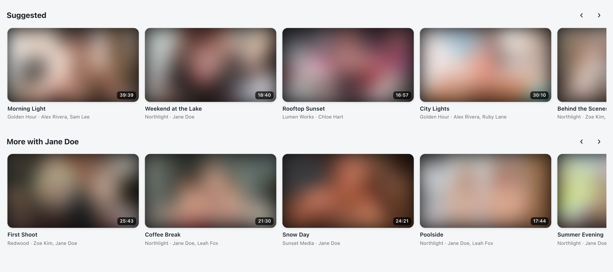
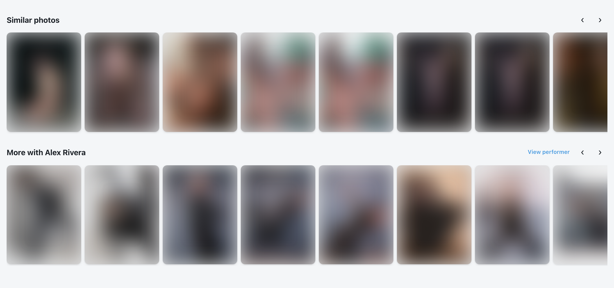
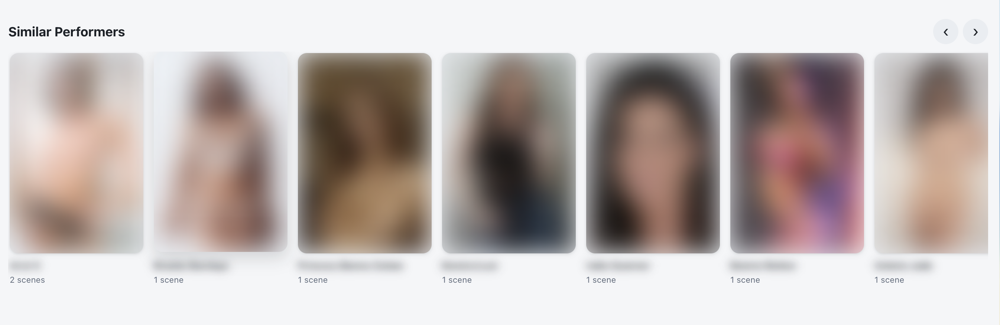
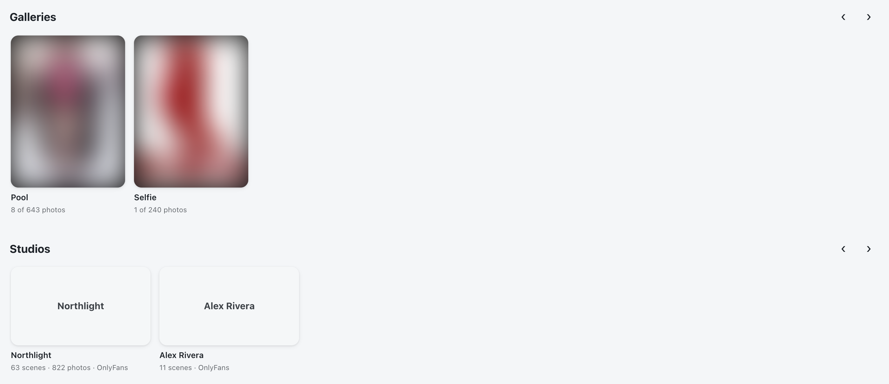

# Stash Suggestions

"Suggested", "Similar photos" and "Similar Performers" rows at the bottom of scene, image and
performer pages (plus a performer's galleries and studios), so there's always something to go to next. Works with any theme, and picks up
[Modern UI](../ModernUI)'s look when that's installed.

*Under a scene: Suggested, then More with [performer]. (Pictures blurred; titles and names are examples.)*

## Scene pages

- **Suggested**: scored by shared tags, same studio, look-alike performers, length and orientation, best match first.
- **More with [performer]**: other scenes with the same performers.
- **Similar Performers**: performers who look like the ones in the scene.

## Image pages

- **Similar photos**: scored by shared tags and galleries (2 points each) and look-alike performers (up to 5). Photos of the same performer are left out, since they have their own row. If there aren't enough matches, it fills up with unorganised photos, then random ones.
- **More from [gallery]** when you came from a gallery, or **More from [row]** when you came from a home page row, using that row's own filter. It's in the same order, starting at the photo you're on (with the 2 before it in view on wider screens); scroll left for earlier ones.
- **More with [performer]**: other photos with the same performers.
- Each row ends with a **Load more** card. With Modern UI, swiping on the next photo moves through the row you picked from.

## Performer pages

- **With the [Better Tagging AI Add-on](../BetterTaggingAI)** installed (optional), Similar photos and
  Suggested also include the photos / scenes that look most alike, and every row counts how alike
  performers' faces look. Without it, everything works the same as before.
- **Similar Performers**: scored by shared tags, ethnicity, hair and eye colour, country, height and age (same gender only). With the [Better Tagging AI Add-on](../BetterTaggingAI) installed, how alike their faces look (from the faces it has learned) counts too, and the closest look-alikes are included even with nothing else in common.

*A performer's Galleries and Studios rows (pictures blurred, example names).*

- **Galleries**: the galleries they're in - tagged on the gallery, or with their photos in it - most of
  their photos first, e.g. "28 of 932 photos".
- **Studios**: the studios of their scenes, photos and galleries, most of their items first, with how
  many of each ("61 scenes · 804 photos") and the parent studio. Studios without a logo show their
  name instead.
- On a performer's page the order is Galleries, Studios, then Similar Performers. A row with nothing
  in it isn't shown.

## Notes

- The rows are hidden while an **Edit** tab is open, so they don't get mixed in with the form.
- Everything runs in your browser using Stash's own data. Nothing is sent anywhere else.
- These rows used to be part of Modern UI (up to version 0.48). Install this plugin alongside Modern UI 0.49 or later to keep them.
- Tested with Stash v0.31.
- Changes are listed in the [changelog](CHANGELOG.md).
