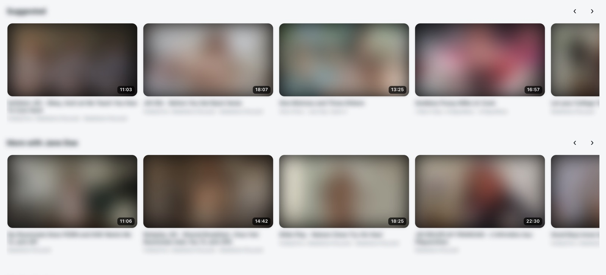
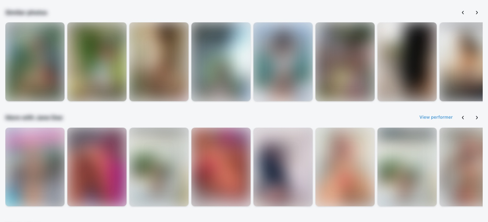

# Stash Suggestions

"Suggested", "Similar photos" and "Similar Performers" rows at the bottom of scene, image and
performer pages, so there's always something to go to next. Works with any theme, and picks up
[Modern UI](../ModernUI)'s look when that's installed.

*Under a scene: Suggested, then More with [performer]. (Pictures, titles and names blurred with [Privacy Blur](../PrivacyBlur).)*

## Scene pages

- **Suggested**: scored by shared tags, same studio, look-alike performers, length and orientation, best match first.
- **More with [performer]**: other scenes with the same performers.
- **Similar Performers**: performers who look like the ones in the scene.

## Image pages

- **Similar photos**: scored by shared tags and galleries (2 points each) and look-alike performers (up to 5). Photos of the same performer are left out, since they have their own row. If there aren't enough matches, it fills up with unorganised photos, then random ones.
- **More from [gallery]** when you came from a gallery, or **More from [row]** when you came from a home page row, using that row's own filter. It's in the same order, starting at the photo you're on (with the 2 before it in view on wider screens); scroll left for earlier ones.
- **More with [performer]**: other photos with the same performers.
- Each row ends with a **Load more** card. With Modern UI, swiping on the next photo moves through the row you picked from.

## Performer pages

- **Similar Performers**: scored by shared tags, ethnicity, hair and eye colour, country, height and age (same gender only).

## Notes

- The rows are hidden while an **Edit** tab is open, so they don't get mixed in with the form.
- Everything runs in your browser using Stash's own data. Nothing is sent anywhere else.
- These rows used to be part of Modern UI (up to version 0.48). Install this plugin alongside Modern UI 0.49 or later to keep them.
- Tested with Stash v0.31.
