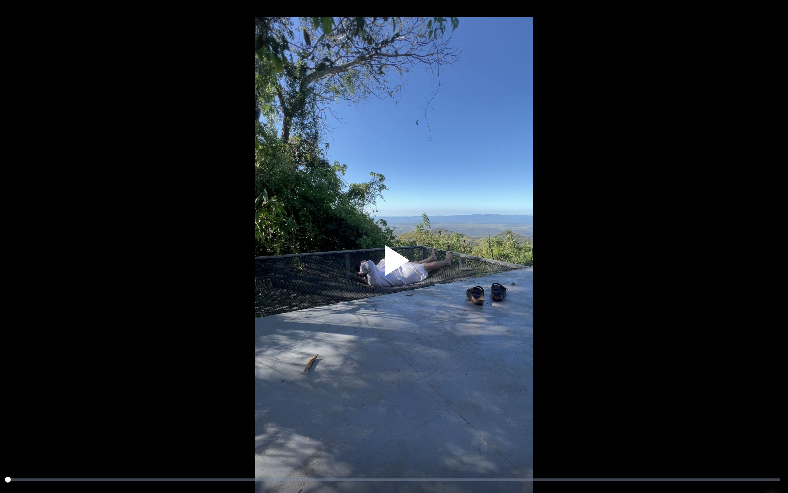
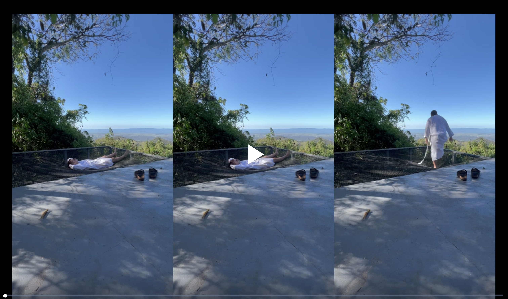

# Vertical Cover Stitcher

Stash's covers are 16:9, so a single frame from a portrait (vertical) video ends up
as a thin strip with big black bars. This plugin builds a proper horizontal cover
instead by taking several evenly spaced frames from the video and placing them side
by side.

| Before | After |
| --- | --- |
|  |  |

*Before: Stash's own cover, a single frame squeezed between black bars. After: three frames from the same video side by side, filling the frame.*

## How it works

- **Automatically**: when a scan adds a new scene, it checks whether the video is
  vertical (taller than it is wide, and longer than 5 seconds), and if so sets a
  stitched cover.
- **On demand**: under **Settings → Tasks → Plugin Tasks**:
  - **Stitch all vertical scenes**: redo the cover of every vertical scene.
  - **Stitch unorganized vertical scenes**: only the ones not marked as organized.

Horizontal videos are never touched.

### Which frames

Frames come from the video's own content, spread out from start to end, leaving out:

- **End cards**: TikTok's and Instagram's (a dark screen with their logo and the account, 4-5
  seconds), and a creator's logo card on black. They're found by what they look like: after a cut,
  dark, flat frames that hardly change until the end.
- **The last 2 seconds**, where phone screen recordings show Control Center being pulled down.

### With Better Organizing AI

If the [Better Organizing AI add-on](../BetterTaggingAI) is installed (in the same plugins folder)
and its face helper runs on a Mac, each frame is the best-looking of three from its part of the video,
by Apple's aesthetics score (frames with people preferred; text screens, blurry or dark frames score
low). The AI add-on also knows which covers this plugin made, and its cover tasks leave them alone. Its
**Suggest covers** button (a scene's Edit tab) also offers stitched covers for vertical scenes, made
with this plugin's code, so you can pick the frames yourself.
Neither is needed: on its own, this plugin uses evenly spaced frames.

## Settings

| Setting | What it does |
| --- | --- |
| Frames per cover | How many frames to stitch side by side: 2, 3 (default) or 4. |

## Requirements

- Python 3 (only the standard library; no extra packages).
- ffmpeg. It uses the one Stash uses: the path set in **Settings → System →
  Application Paths**, the system PATH, or the copy Stash downloads into its config
  folder. The official Docker image already includes it.

## Notes

- Each cover it sets is noted in Stash's config folder (`plugin-data/vertical_stitcher/stitched.json`,
  a tiny grey copy) for the AI add-on.
- It replaces the scene's current cover. Scraping or identifying the scene later
  may replace it again with the site's own cover.
- Covers are 1280×720 JPEGs.
- Changes are listed in the [changelog](CHANGELOG.md).
